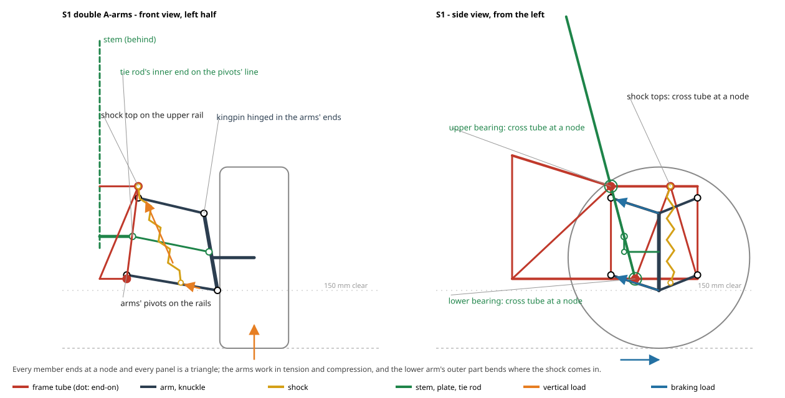
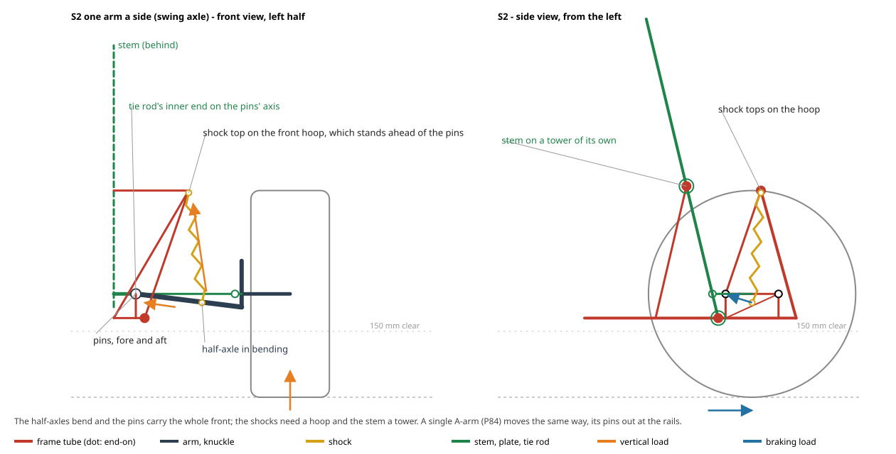
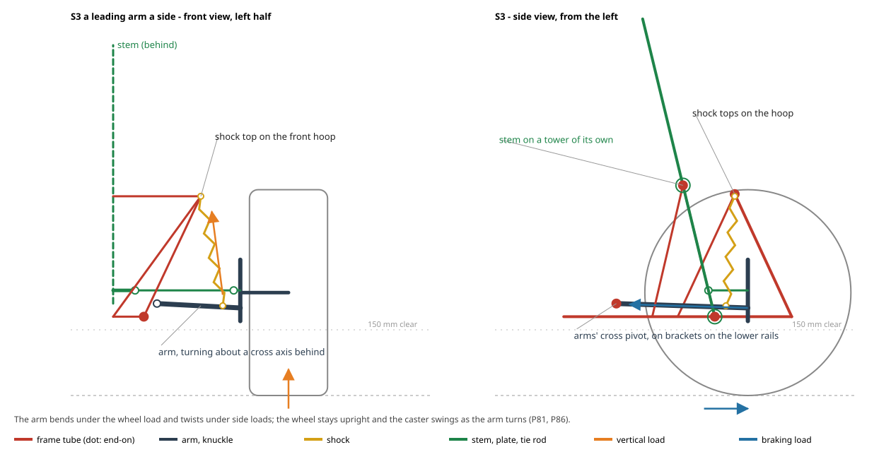
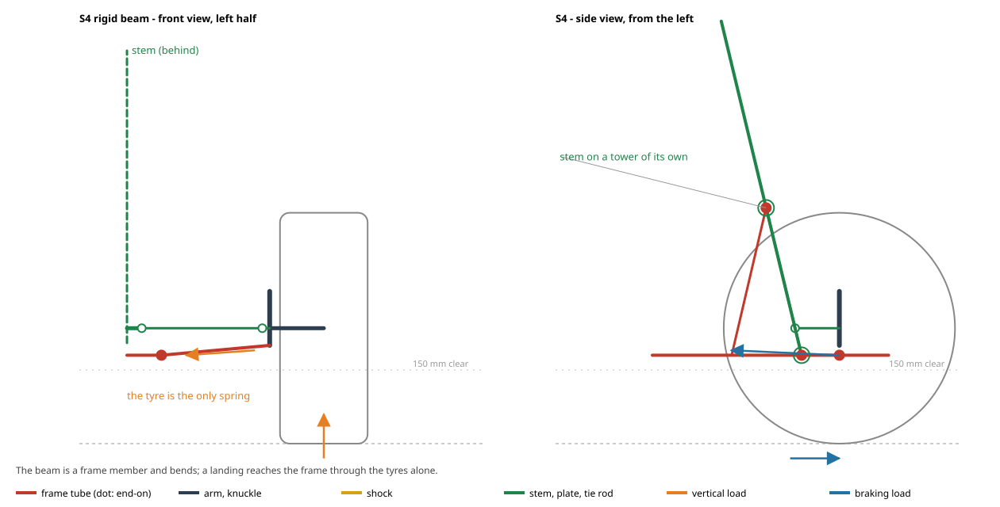
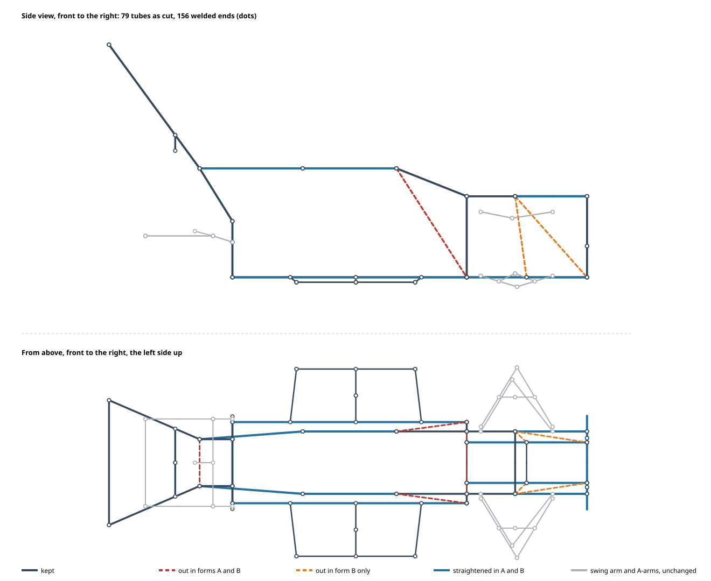

# 1.2 Form

Candidate forms, the yardsticks, rough availability and cost of each, the comparison, and the selection.

Numbers are cited by key and listed in [docs/01-requirements.md#values](01-requirements.md#values).
The rough numbers come from `python calc/form_rough.py`, which reads its inputs from the record and writes its outputs back as calculated values.
Inputs that are only assumed so that forms can be compared wait in Q-009 (shapes and masses), Q-010 (prices), Q-014 (grip for the simulator), and Q-027 (the snowmobile form and the tub); 1.3 and 1.5 replace them.

## 1.2.1 Yardsticks {#yardsticks}

The requirements that separate forms are R-04 (three grounds), R-05 and R-06 (snow), R-07 (cold), R-08 (budget), R-12 (tipping), R-14 (carried in the owner's car), and R-16 (a fairly steep slope climbed slowly without damage).
R-01, R-10, and R-17 decide how the speed is limited and how the drive is cut, which differs between an engine and a motor.
The builder's tools matter too: the owner would buy a welder (D-008), so welding is allowed but is a tool cost outside the budget.

## 1.2.2 Candidates {#candidates}

The form is four choices, and the parts can come new or from a used donor.

| Choice | Candidates |
|--------|-----------|
| Layout | L1 low kart like a racing kart, on 5 inch wheels. L2 off-road kart with a raised floor and 13 inch tyres. L3 tracks all year. L5 the owner's own frame on the axle, wheels, brake, steering, and engine of a used buggy. |
| Winter setup (for L1, L2, L5) | W1 front skis bolted to the spindles and chains on the rear tyres. W2 front skis and a pair of rubber tracks in place of the rear wheels. |
| Frame | F1 welded steel tube. F2 bolted aluminium extrusion. F3 bolted steel square tube. |
| Power | E1 clone engine of the GX200 class with a centrifugal clutch. E1t the same with a torque converter. E1h a genuine Honda engine. E2 electric 1 kW kit with four 12 V batteries. E3 electric 2 kW kit with one 48 V LiFePO4 battery. |

Front skis bolted to the spindles in place of the front wheels are how ATVs and a converted shifter kart were made to run on snow (F1).
Snowblower rubber tracks are sold in Japan without sprockets or idlers (M13); a complete rear-axle track kit is sold abroad (M14).

## 1.2.3 Mass {#mass}

form.mass_total_kg is the rough kart mass kart.mass_rough_kg plus the heaviest rider rider.mass_max_kg (D-009).
A leisure kart of similar size, the GR KART, is listed in P9, and is heavier than the rough value because of its body panels.

## 1.2.4 Snow {#snow}

**Wheels in fresh snow.** CRREL's fit for wheeled vehicles (P1) gives the sinkage z = h (1 − ρ0 / ρf), where h is snow.depth_max_cm, ρ0 the initial snow density between snow.density_initial_min and snow.density_initial_max, and the final density ρf = snow.crrel_rhof_a + snow.crrel_rhof_b × p.
In P1, p is the maximum contact pressure of the wheels; tyre.pressure_kpa is used in its place and lies below the fitted range, but even p = 0 leaves the conclusion unchanged (K-001).
The sinkage is between snow.wheel_sinkage_min_cm and snow.wheel_sinkage_max_cm, more than the tyre radius, so the hubs, the axle, and its brake disc and sprocket run in the snow as well as the floor at kart.clearance_rough_mm.
A wheeled kart therefore cannot meet R-06 at snow.depth_max_cm.
In the lightest snow it clears snow.wheel_depth_limit_cm with its floor, but only snow.wheel_depth_limit_axle_cm with its lowest axle part at kart.axle_part_low_rough_mm; thin parts cut snow rather than plough it, so the real limit lies between the two.
The owner accepts a low speed on snow (D-011), which removes the speed rating of tracks and skis as a concern.

**Tracks and skis.** A pair of snowblower tracks of width track.width_mm, with track.links links of track.pitch_mm, on a sprocket and an idler of track.wheel_dia_mm, carries the rear share kart.rear_share at snow.track_pressure_kpa.
Front skis of ski.width_mm by ski.contact_length_mm carry the rest at snow.ski_pressure_kpa.
Both are close to a snowmobile's snow.snowmobile_pressure_kpa (P2).
Bekker's relation p = (kc / b + kφ) zⁿ with the three snows of P2 (snow.bekker_a_n to snow.bekker_c_kphi) gives sinkage of at most snow.track_sinkage_max_cm for the tracks and snow.ski_sinkage_max_cm for the skis, which the raised floor clears.
That assumes the belt presses evenly. A snowblower track looped over only a sprocket and an idler carries the load under those two wheels; Bekker's wheel relation z = [3W / ((3 − n)(kc + b kφ) √D)]^(2 / (2n + 1)) for each of the four wheels gives snow.track_sinkage_wheels_cm, which the floor does not clear (K-001). That sinkage exceeds the wheel diameter, outside the relation's small-sinkage range, and the exact wheel geometry gives as much or more (K-002).
Replacing the rear tyres by a track on smaller wheels also lowers the rear axle, and with it the floor, unless the track frame raises the axle (K-002).
So W1 fails R-06, and W2 is not shown to pass: the truth lies between the two track figures, P1 does not cover tracked vehicles, and P2's snows are not the owner's snow.
W2 would need road wheels between the sprocket and the idler to spread the load, which adds to cost.allow_track_gear_jpy.
A loaded-plate test in the owner's fresh snow (Q-012) settles the sinkage cheaply before the frame is given mounts for W2.
Turning a pair of tracks on a solid rear axle with ski steering is not yet assessed.

**Grip on packed snow and ice.** Car data reviewed in S1 give the sideways friction on snow ground.mu_snow with plain tyres and ground.mu_snow_chains with chains, and on ice ground.mu_ice and ground.mu_ice_chains: chains roughly double it.
Front skis need a keel or a runner to steer; this is a 1.3 item.

These are estimates: P1 was fitted for heavier vehicles, and the Bekker values come from three snows that may differ from the owner's snow. R-06 is verified by test.

## 1.2.5 Drive {#drive}

The tyre diameter tyre.dia_mm is the 13 inch outside diameter of a 13x5.00-6 tyre, as its name states, and tyre.width_mm its 5.00 inch section width.
The owner lowered the top speed to kart.speed_max_kmh (D-015, superseding D-003); each power source is geared lower, which raises the force at the tyres in the same proportion.
The engine is geared so that its governed no-load speed engine.speed_noload_rpm (assumed until Q-011) gives kart.speed_max_kmh, which enforces R-01 on level ground and uphill; running faster downhill is a 1.3 item. P4's engine.speed_rated_rpm is the speed of rated output, and gearing to it would let the kart pass kart.speed_max_kmh (K-001).
A motor is geared at its rated speed here, which is below its no-load speed, so the electric figures are generous to the motors (K-003).

The kart must climb a fairly steep slope slowly without damage (R-16, D-014), assumed at site.grade_max_pct until Q-008.
On long grass, with the rolling resistance ground.crr_max of ATV tyres (P24), that needs drive.climb_force_n.

- E1: the maximum power engine.power_max_kw at engine.speed_rated_rpm (P4), the reduction drive.engine_ratio, and drive.efficiency give drive.engine_thrust_n at the rear tyres; at the continuous rating engine.power_cont_kw it is drive.engine_thrust_cont_n. Both are above drive.climb_force_n. A clone is assumed to match the genuine engine; 1.3 checks the chosen engine's data. The rolling resistance ground.crr_max was measured on larger ATV tyres; smaller tyres sink further in grass and need more (K-003).
- **Grip, not power, limits the climb on grass.** The rear tyres must pass drive.climb_force_n to the ground. Even with the load moving rearward on the slope, that needs a friction coefficient near the assumed ground.mu_grass, which is not from a source (Q-014). The simulator's R-16 test (see the 3D simulator) shows the kart climbing site.grade_max_pct on short grass with its rear tyres spinning much of the way, and not climbing it on long grass; on gravel it climbs. More grip (tyres with a turf or knobbly tread), more of the mass over the rear axle, or a gentler slope are the ways out, and 1.3 takes them up with the owner's answer to Q-008.
- E2: a motor's force is its rated torque scaled by the controller's current over the motor's rated current. The 1 kW motor (motor.torque_rated_nm, motor.current_rated_a, M5) on its kit's controller (motor.controller_a, M3) gives drive.motor_thrust_n. The torque comes from a brushed motor and the price from a brushless kit, so the two do not describe one product.
- E3: the 2 kW motor (motor2.torque_rated_nm at motor2.speed_rated_rpm, M19, seen only as an excerpt) on its kit's controller (motor2.controller_a) gives drive.motor2_thrust_n.
- Both electric kits fall short of drive.climb_force_n on grass, and of the slope alone on pavement (K-002). The 2 kW data do not agree with each other: its torque at its speed is more shaft power than its current can supply, so motor2.current_rated_a is probably the controller's rating copied over (K-002). If the controllers limit the battery current rather than the motor current, a motor can take more current on a slow climb; that is not assessed.
- Battery run time is marginal rather than failing. One 48 V pack of battery.energy_wh (M21), at a mean speed drive.speed_avg_kmh on grass with the heaviest rider, draws drive.power_avg_heavy_w and lasts battery.run_time_heavy_min, just over kart.run_time_min (D-013); long grass, slopes, starts, and cold shorten it (K-003).
- On level long grass at kart.speed_max_kmh the drive must deliver drive.grass_power_kw, within E1 and close to what E3 delivers on its own controller.
- **Clutch.** A generic centrifugal clutch begins to grip at clutch.engage_rpm and locks at clutch.lock_rpm (M23). Geared as above, it lets go below drive.clutch_engage_kmh and slips at any steady speed below drive.clutch_lock_kmh; it starts the kart from rest by slipping. A seller quoting the clutch maker warns that driving too slowly, restricting the throttle, hills, and deep grass ruin a clutch, and that rear wheels over 15 inch need a torque converter (M23).
- With full throttle the clutch locks within a moment, because the rear tyres spin up when grip runs out (simulator); so on a slope it is the tyres, not the clutch, that slip. Creeping up at part throttle, or holding the kart on the slope with the throttle, slips the clutch instead. The rule for E1 is therefore to climb at full throttle, and to stop on a slope with the brake, not the throttle; a restart on the slope slips the clutch for a few seconds (K-003). Climbing at the lock speed is not the slow climb the owner allowed (D-014), which the owner should accept or not.
- E1t, a torque converter (M24: low ratio tc.ratio_low, high ratio tc.ratio_high; a clone kit costs cost.tc_kit_jpy, M25), keeps the engine above lock while the kart creeps, and suits slow climbing and deep snow. At the earlier top speed it would have been needed for the slope as well; lowering the top speed (D-015) is what lets the cheaper clutch stand.
- The clone engines found (M18) do not state a governor, while the genuine engine has one (P5). A clone must have a working governor, checked when it arrives, or R-01 fails.
- One chain from a sprocket.engine_teeth tooth clutch sprocket of pitch sprocket.pitch_mm (chain size 40, 1/2 inch by its name, which the clutch of M2 takes) to the axle would need an axle sprocket whose teeth reach to drive.sprocket_reach_mm above the ground. A second reduction stage (a jackshaft) is needed; its rough price is cost.allow_reduction_jpy.

## 1.2.6 Stability {#stability}

With the heaviest rider seated rider.cg_above_seat_m above a seat seat.above_floor_rough_m over the floor, and the kart's own centre at kart.cg_height_rough_m, the centre of mass is at form.cg_height_m.
R-12 with kart.tip_ratio_min then needs a track of at least form.track_min_m on level ground.
With its tyres the kart is form.width_overall_m wide, close to a leisure kart's kart.ref_leisure_width_mm (P9). Kart rules ask for a track of at least two thirds of the wheelbase (P10). The track was rounded up to whole centimetres.
Standing sideways on site.grade_max_pct, the same margin needs form.track_min_slope_m, far wider than a leisure kart and than the owner's car can carry (1.2.7).
The assistant proposes that R-12 holds on level ground, and that slopes are driven straight up and down only, written as an operating rule in step 3 that controls H-05. The owner decides with Q-005.
A raised floor costs stability, which is why the floor is not raised further to let wheels clear deep snow.

## 1.2.7 Transport {#transport}

The kart is carried in a Delica D:5 (D-012, R-14).
Its overall width form.width_overall_m (the track form.track_min_m plus a tyre width tyre.width_mm) is about the tailgate opening at its widest, delica.opening_width_max_mm (before rounding the track it is equal), and far more than the opening at its narrowest, delica.opening_width_min_mm, and the width between the flipped-up third-row seats, delica.cargo_width_min_mm (P26, P27).
Its length kart.length_rough_mm fits the cargo length delica.cargo_length_mm with the second row tipped up and slid forward.
So a kart as wide as R-12 asks does not go in on its wheels. The ways out are:

- T1 a rear track that narrows for transport, with hubs that slide along the live axle and front stub axles that come off without tools, so that the kart rolls in narrow and is widened on site;
- T2 taking the wheels off and loading the frame on a small dolly;
- T3 a narrower kart that keeps R-12 only with the child and is driven gently by adults;
- T4 a small trailer, outside the budget.

The sources give the narrowest and widest widths but not at what height each lies, nor how high the flipped-up seats sit; the owner can measure them in the car (Q-015).
T3 has a second use: the axle and wheels of a donor buggy (1.2.10) are narrow, so a narrow kart can use them as they are.
The cargo floor lip is at delica.lip_height_mm, so one adult loading alone (R-15) needs a ramp, designed in 1.3.

## 1.2.8 Cold {#cold}

- Engine: Honda's oil chart for the GX series covers starting down to about -15 degC (P5), below ambient.temp_min_c. Pass.
- LiFePO4 batteries discharge down to -20 degC with most of their capacity, but must not be charged below 0 degC (P6). The kart is kept outdoors under a roof (D-012), so batteries must be taken indoors to charge.
- Sealed lead-acid batteries are recommended for cyclic use only above +5 degC and lose much of their capacity in the cold at high discharge rates (P7). They are ruled out for E2.

## 1.2.9 What the safety sources add {#safety}

- **Law.** On land not used for general traffic, the Road Traffic Act does not apply (P11, P12), and use only off roads is not operation under the Road Transport Vehicle Act (P13). If people other than the family pass freely through the land, it may count as a road. Civil liability remains (P14).
- **Main causes of harm.** In US data, children were hurt or killed mostly by hitting objects or vehicles and by tipping over on bumps, ruts, and sharp turns; hair or clothing caught in an exposed chain, belt, or axle killed several (P19). Japan's Consumer Affairs Agency advises removing scarves and keeping long hair inside the helmet (P20). This supports R-11 covering the axle as well as the chain, and R-12.
- **Guards and stopping.** JAF's guideline for leisure kart events asks for guards against hair and scarves, pedals and seat adjustable to body size, brakes on both rear wheels, and an emergency stop with a remote speed limit or engine stop (P16). JAF's rules require a chain guard over the upper run (P17).
- **No seat belt.** Race karts have no roll bar and prohibit seat belts (P18). The kart follows that: no belt without a roll bar.
- **Braking distance.** No kart standard with a stopping distance could be read; ASTM's fun-kart standard excludes home-made karts and may not be given to an AI (P23). The Japanese rule for mopeds (P15) gives, at the top speed, a limit for linked brakes that is longer than the assumed kart.stop_distance_max_m. Section 1.2.12 proposes which to use.
- **A young driver.** The youngest driver is 5 (D-010). US youth ATV guidance allows no ATVs under 6 and limits ages 6 and up to a low speed with the restrictor (P25, S2), which is why R-17 proposed a child limit; the owner decided against it (D-018).
- **Body sizes.** The seat and pedals reach down to rider.stature_min_cm, the small end for a 5-year-old (P21), and up to rider.stature_max_cm, the tallest adult (D-016).

## 1.2.10 Cost {#cost}

Prices are from sales pages read on 2026-11-03, taking the higher price where a range was seen. Allowances are assumed in Q-010.

| Part of the kart | Key |
|------------------|-----|
| Chassis of L2 with F1: tube, rear axle kit, steering kit, tyres, seat, pedals and cables, stop switch, guards and mounts, small parts | cost.chassis_jpy |
| E1 clone engine, clutch, jackshaft, drive chains | cost.power_engine_clone_jpy |
| E1h genuine Honda engine, clutch, jackshaft, drive chains | cost.power_engine_genuine_jpy |
| E2 1 kW kit, four LiFePO4 batteries, charger, wiring, drive chain | cost.power_electric_jpy |
| E3 2 kW kit, 48 V LiFePO4 battery, charger, wiring, drive chain | cost.power_electric2_jpy |
| W1 skis and chains | cost.winter_skis_chains_jpy |
| W2 skis and tracks with running gear | cost.winter_tracks_jpy |
| Whole kart L2 + F1 + E1 + W1, new parts | cost.total_l2_e1_w1_jpy |
| Whole kart L2 + F1 + E1 + W2, new parts | cost.total_l2_e1_w2_jpy |
| Whole kart L2 + F1 + E1 + W1, the cheapest new parts seen (M17, M28 to M31) | cost.total_cheap_new_w1_jpy |
| Whole kart L5 + F1 + W1 on a used buggy donor (M26) with its own engine and a new wide axle and brake, from the cheapest running donor to the dearest donor seen | cost.total_donor_min_w1_jpy to cost.total_donor_w1_jpy |
| The same with E1 in place of the donor's engine | cost.total_donor_e1_w1_jpy |
| The least kart: a running donor's narrow axle and wheels as they are (T3), the owner's frame, no winter parts | cost.total_donor_narrow_summer_jpy |

Every combination of new parts that meets R-04 costs more than budget.parts_jpy (R-08).
The parts that drive the excess are the power, the rear axle kit, the tyres, the many small parts (pedals, cables, guards, chains, a jackshaft), and, for R-06, the tracks.

**Can it be made cheaper?** Lowering the top speed (D-015) did not lower the price of the parts themselves, but it spared the torque converter that the slope would otherwise need (1.2.5).
The cheapest new parts seen save little, because the small parts and allowances weigh as much as the big parts.
A used buggy as a donor saves more, but less than it first seemed (K-003).
Used buggies sell for cost.donor_buggy_min_jpy as junk and from cost.donor_buggy_running_min_jpy running, up to cost.donor_buggy_max_jpy (M26).
A buggy's rear axle is narrower than R-12 asks and does not let the track narrow for the car (T1), so a full kart needs a new axle with hubs and a brake, and keeps from the donor only the wheels, the steering, and the engine with its gearbox.
That engine is not E1: it has no governor and has its own clutch and gears, so how it is held to kart.speed_max_kmh, and how it climbs (R-16), are not yet analysed; with E1 in its place the donor route costs as much as new parts.
The other risks are that listings do not itemise their parts or state a load rating for an adult (R-02), that many are for pickup only, and that the condition is unknown until it is taken apart.
A used engine (cost.engine_used_min_jpy to cost.engine_used_max_jpy, M27) costs about the same as a new clone.

**What it takes to reach the budget.** No route that keeps every requirement reaches budget.parts_jpy. The kart reaches it only by giving something up: the least kart, cost.total_donor_narrow_summer_jpy, keeps a running donor's narrow axle and wheels, which meets R-12 with the child but not with an adult (the child's centre of mass is lower), fits the car more easily (R-14), and leaves the winter parts for later.

## 1.2.11 Comparison {#comparison}

| Form | R-04 grounds | R-05 packed snow | R-06 fresh snow | R-12 | Cost | Kept? |
|------|--------------|------------------|-----------------|------|------|-------|
| L1 low kart | fails on gravel and grass (floor too low) | passes with W1 | fails | passes | lowest; used frames are cheap (M16) | no |
| L2 off-road kart + W1 | passes | passes | only up to between snow.wheel_depth_limit_axle_cm and snow.wheel_depth_limit_cm | passes on level ground with track form.track_min_m | new parts | yes |
| L2 off-road kart + W2 | passes | passes | not shown; needs road wheels and the test of Q-012 | as above | new parts + tracks | later, after Q-012 |
| L3 tracks all year | grass torn, tracks worn on pavement | passes | passes | not assessed | above L2 + W2 | no |
| L5 own frame on a donor buggy + W1 | passes if the donor's parts carry an adult | passes | as L2 + W1 | passes on level ground with a new wide axle; with the donor's narrow axle, only with the child | below new parts, above the budget | yes |

| Frame | Tools | Strength and joints | Kept? |
|-------|-------|---------------------|-------|
| F1 welded steel tube (M6, M7) | a 100 V no-gas welder (P8, M11) | the usual kart frame (P10); no joints to loosen | yes |
| F2 bolted aluminium extrusion (M12) | none | dearer per metre, brackets extra, some sellers refuse home delivery; bolted joints may loosen under vibration (R-02) | no |
| F3 bolted steel square tube | drill | cheap, but many bolted joints with the same risk as F2 | no |

| Power | Grade (R-04, R-16) | Cold (R-07) | Speed limit (R-01, R-17) | Other | Kept? |
|-------|--------------|-------------|--------------------|-------|-------|
| E1 clone engine, centrifugal clutch | force passes; on grass the tyres' grip limits (assumed, Q-014); climb at full throttle | passes | gearing to the governed speed (Q-011); governor to be checked | noise, fuel, hot exhaust (H-04), recoil start | yes |
| E1t clone engine, torque converter | passes, also creeping | passes | as E1 | dearer by the converter | if creeping matters |
| E1h genuine engine | as E1 | passes | as E1 | known quality, dearer | yes |
| E2 1 kW electric | fails, even on pavement | charge indoors only | controller setting | quiet, no fuel, dearer | no |
| E3 2 kW electric | fails on grass with its controller | charge indoors only | controller setting | quiet, no fuel, no hot exhaust; the dearest | only with a larger controller, not assessed |

## 1.2.12 Proposal and the owner's decisions {#proposal}

The assistant proposes an off-road kart on the owner's welded frame (F1) with a clone engine and a centrifugal clutch (E1), built first with W1, slopes climbed straight up at full throttle and stopped with the brake, a rear track that narrows for the car (T1), and the plate test of Q-012 this winter to decide whether and how W2 is added later.
On new parts this costs cost.total_l2_e1_w1_jpy against budget.parts_jpy (R-08).

The owner decides:

1. **Cost against requirements.** (a) New parts (L2 + E1), cost.total_l2_e1_w1_jpy, every requirement kept (proposed). (b) A used buggy as donor with a new wide axle (L5), cost.total_donor_min_w1_jpy to cost.total_donor_w1_jpy, keeping the donor's engine, whose speed limit and climb are then analysed in 1.3. (c) The least kart, cost.total_donor_narrow_summer_jpy: a donor's narrow axle as it is, stable with the child but not with an adult (R-12), winter parts later. (d) The cheapest new parts, cost.total_cheap_new_w1_jpy, which saves little.
2. **R-06 against R-08.** (a) Build with W1 now, run the plate test of Q-012 this winter, and add W2 as a second stage with its own budget if the test supports it. (b) Change R-06 to fresh snow up to the W1 limit, between snow.wheel_depth_limit_axle_cm and snow.wheel_depth_limit_cm. (c) Design and build W2 now and accept the larger excess (cost.total_l2_e1_w2_jpy) without the test.
3. **Transport.** T1 (proposed), T2, T3, or T4; and the owner's measurement of the car (Q-015).
4. **Slopes.** R-12 on level ground with the rule "straight up and down" (proposed), or a wider or lower kart.
5. **Power.** E1 with a centrifugal clutch and the rule to climb at full throttle (proposed, the cheapest), E1t if the kart must creep up slopes, E1h for a genuine engine, or an electric drive with a larger controller if a quiet kart without fuel or hot exhaust matters more than cost and climbing grass.
6. **Frame.** F1 with a welder bought as a tool (proposed), or F2 without welding.
7. **Stopping distance (R-09, T3).** Current: kart.stop_distance_max_m, assumed. Proposed: keep it as the design point, because a kart has a lower centre of mass than a moped and brakes are cheap, and record the moped limit from P15 as the floor below which the kart fails.
8. **A child limit (R-17).** Decided: none (D-018).

After the owner decides, 1.2 records the selection, adds the hazards of the chosen power source (fuel, exhaust gas in a closed shed), and 1.3 starts the design calculation and the drawings.

## 1.2.13 Road use and the engine {#road}

The owner wants the kart on public roads too (D-019) at about kart.speed_max_kmh (D-020), and puts road use before the slope (D-021). Helpers read the law and the engines on 2026-11-04.

**Class.** A four-wheel vehicle is a moped under the vehicle law only up to law.minicar_cc_max or law.minicar_kw_max rated (P35); the new 125 cc class of 2025 is for two-wheelers only. In traffic law it is then a minicar: an ordinary driving licence, one person, no helmet duty, a seat belt worn, the road limit law.speed_road_kmh but law.speed_lane_kmh on general roads without a centre line (P38). From 51 cc a four-wheeler is a light motor vehicle that needs inspection and collision tests (P35, P39), which a home-built kart cannot pass. So the road-legal engine is at most law.minicar_cc_max, or an electric drive of at most law.minicar_kw_max rated.

**What the law asks of the kart (P36, P37).** Size within law.length_max_mm by law.width_max_mm; two brake systems, the service brake on at least half the wheels including the rear, a parking brake that holds on law.parking_grade_pct; head, tail, stop, and number plate lamps, a rear reflector, front and rear turn signals, a mirror, a horn, a speedometer, and an approved silencer; a seat, a seat belt and a head restraint for a seat that is not straddled; and, because the seat is lower than 500 mm, a structure at least law.marker_height_mm above the ground so that others see the kart. Nobody inspects a moped; meeting the standards is the owner's duty, and the plate is only a tax step (P40). The tax is cost.tax_year_jpy a year (P41), and compulsory insurance about cost.cali_year_jpy a year (P42). How a frame built from scratch gets its number is not on any official page found (Q-022).

**Consequences for the form.**
- The seat belt the law requires changes the safety reasoning of 1.2.9: a belted driver must be protected if the kart rolls, so the seat-back hoop becomes a roll bar over the driver's head, which can also be the marker structure.
- The engines of 1.2.2 (GX200 class) are out for road use. Candidates within the limit: a 50 cc four-stroke scooter engine with its CVT and centrifugal clutch (eng50.kw at eng50.rpm, eng50.torque_nm, CVT eng50.cvt_low to eng50.cvt_high, P43; used cost.engine50_used_min_jpy to cost.engine50_used_max_jpy, M63), a Super Cub 50 engine with four speeds and an automatic clutch (cub50.kw, cub50.torque_nm, P44, M64), or an electric drive of law.minicar_kw_max rated, too weak for an adult on a slope.
- A scooter engine brings its own clutch and reduction, which removes the jackshaft, the second chain, and the crowding of Q-020; it was built to the emission and noise rules, keeps its own approved silencer, and has the generator and wiring for the lamps. Its fuel injection brings an ECU, a fuel pump, and a battery with it.
- The road limit and R-01 meet: the CVT's top ratio and the final chain set the top speed at the engine's limited speed, since a scooter has no governor.

These are rough; the next pass chooses the engine, turns the law's list into requirements (R-18, Q-021), and redesigns 1.3.

## 1.2.14 The snowmobile form {#snowmobile}

The owner wants a personal vehicle for the far outdoors, changed each winter into a snowmobile form that crosses fresh snow of about snow.depth_max_cm where nobody clears it, and back to tyres in summer (D-023). This pass adds a third winter setup to the two of 1.2.2 and sizes it roughly. The summer form stays the road-going design of 1.3 (D-022). Helpers read the market, the law, and the materials on 2026-11-04.

**Candidates.** W1 (skis and chains) and W2 (skis and a pair of snowblower tracks) of 1.2.4 sink deeper than snow.depth_max_cm allows and are kept only for packed snow. The new setup is:

- **W3, the snowmobile form.** Two skis on the front spindles, as in W1, and the rear axle with its wheels replaced by one centre track unit from a used snowmobile (track, slide rails with idler wheels, and drive shaft with sprockets), bolted where the axle's bearing plates are. The floor becomes a sled bottom: an open tub of plastic sheet over closed-cell foam around the seat (1.2.15), which spreads the load when the kart sinks to its floor and floats it in water.

- **W5, large rear tyres and skis.** In winter the rear wheels change to large low-pressure tyres on the same hubs with a larger axle sprocket, and skis replace the front wheels. The larger tyres lift the whole chassis, so the axle's low parts and the sled pan ride above the tyres' sinkage and the snow between the ruts passes under the kart, like a saddle between two tracks. It came from the owner's questions on wide tyres and on skis packing a path for the tyres (that effect is small: the skis press about a quarter of what the tyres do). How large tyres sink and push is in W4's figures below (w4.big_*). It was the working basis of 1.3 until the owner chose W6 of 1.2.19 (D-032).
- **W4, a sled bottom pushed by the tyres** (D-029). The summer rear axle stays, with chains on the rear tyres pressed down on sprung arms; the sled pan carries the rest of the weight and the front runs on skis. With the tyres carrying w4.wheel_share of the weight with the adult they sink w4.wheel_sink_cm and grip at w4.grip_n (CRREL's fit for shallow undisturbed snow, P59). What resists is the pan sliding (up to sled.mu_packed of its load on cold snow, P60) and the tyres pressing their ruts, which two estimates bracket: taken as ground.crr_snow_fresh of their load (P1), the total is w4.resistance_n and the tyres push, needing a share of at least w4.share_min; taken as the work of pressing ruts that deep (Bekker, P2), it is w4.resistance_bekker_n and they do not. The tyres sink w4.wheel_drop_mm deeper than the pan, while they reach only hull.bottom_clear_mm below it as the kart is now, so they need arms that let them drop and press them down, and the hubs need a diameter of at least w4.tyre_dia_min_mm to stay out of the snow.
  A second tyre bolted outside each rear tyre in winter, as tractors use duals, spreads the load over four: they sink w4.dual_wheel_sink_cm and grip at w4.dual_grip_n, which pushes with P1's resistance from a share of w4.dual_share_min, and against Bekker's estimate of w4.dual_resistance_bekker_n. There is no room for them inside the rear tyres, and outside they make the kart w4.dual_width_m wide, wider than law.width_max_mm and the car's opening, so they go on and off on site in winter. Large low-pressure tyres of w4.big_tyre_dia_mm by w4.big_tyre_width_mm do better: two sink w4.big_wheel_sink_cm and grip at w4.big_grip_n against w4.big_resistance_bekker_n even by Bekker's estimate, and four sink w4.big_dual_wheel_sink_cm and grip at w4.big_dual_grip_n against w4.big_dual_resistance_bekker_n. A sled starting from cold resists about twice as much (P60), and the bow's pushing of a snow wall is left out.
  Precedents agree with tyres being large: the Girling motor sledge of 1914 rode on runners and was pulled by two scoop-rimmed wheels about 1 m across (F4), and on a Weddell Sea floe the expedition's motor crawler and warper - by its drum and wire likely that sledge - ran at about six miles an hour over ice under a foot or two of soft snow (P63); a car with its rear wheels on snowboards and chains on its driven front wheels lapped untouched snow up to 30 cm deep (F5); and patents put sprung, height-adjustable drive wheels through openings in the runners (P65). Cars that carried their weight on their wheels dug in and spun in soft snow (P64). No record of a wheel-pushed sled in fresh snow near 1 m deep was found, and P2's snows may be denser than the owner's new powder. So W4 with the summer tyres suits shallow and packed snow, and needs large tyres for more. The summer form with chains, with two tyres and with duals, is tried in fresh snow before the donor is bought (plan t6).

**Donor.** No skid frame or drive shaft was found sold on its own in Japan. The smallest adult snowmobile found among the listings (M80), Yamaha's Bravo, has a track sm.track_width_mm wide touching the snow over sm.track_contact_mm (P51), and sells running for about cost.donor_bravo_jpy (M80); its whole rear half is the track unit of W3. Kids' snowmobiles have tracks of 254 mm and are made for children (S7); large sleds sold as junk are cheap but their tracks are far too long for the kart (M80).

**Masses and pressures.** The winter kart is sm.mass_kg: the summer kart of dsn.mass_kg less sm.removed_kg of wheels and axle, plus a track unit of sm.track_unit_kg, skis of ski.pair_kg, and the tub of hull.mass_kg. With the track's centre under the summer axle (sm.track_x_mm), the track carries sm.rear_share of the weight with the heaviest rider. It presses sm.track_pressure_kpa, close to a snowmobile's snow.snowmobile_pressure_kpa (P2); the skis press sm.ski_pressure_kpa; and the tub's bottom, if the kart sinks onto it, spreads the whole weight at sm.hull_pressure_kpa, below a person on snowshoes (S4). Bekker's relation with the snows of P2 gives sinkages of at most sm.track_sinkage_max_cm, sm.ski_sinkage_max_cm, and sm.hull_sinkage_max_cm. P2's snows are denser than new powder, and P1 covers neither tracks nor such low pressures, so these figures say only that W3 is in the range where snowmobiles work. Whether it floats on the owner's deepest snow is settled by the snowshoe test of Q-012.

**What the figures leave out.** Snow higher than the tub's bow is pushed ahead or must be climbed. In about 1 m of new powder a snowmobile stays on top by its speed; a slow machine sinks until the snow under it bears it. The bow is therefore raised and curved like a sled's. The traction of one track in loose snow is not estimated, for lack of shear data for the owner's snow.

**Power.** The scooter unit gives eng50.kw to sm.mass_kg with an adult of rider.mass_max_kg, about a quarter of the power per mass of a Bravo with the same adult (18 hp, about 150 to 168 kg, S3; 184 kg with oil and fuel, P51), the least powerful adult snowmobile found in the listings. The electric snow bike SIN EV the owner pointed to carries up to 270 kg on a 4 kW motor (M79), close to the scooter unit per mass, but its makers state no snow depth. Running at sm.speed_snow_kmh in fresh snow takes about sm.power_snow_kw with the assumed resistance track.crr_snow_fresh, well within eng50.kw; the doubt is deep powder, where the snowmobiles that work have about four times the power per mass. Two drives are therefore candidates:

- **D1, the summer engine.** The CVT and the summer chain turn the track's drive sprocket of sm.drive_dia_mm. The centrifugal clutch locks at about sm.clutch_lock_kmh (with su.clutch_lock_rpm assumed, Q-023), so it slips only when starting, and the top speed is sm.top_speed_kmh, slow as D-011 allows. One engine serves both forms.
- **D2, the donor's engine.** The donor's own engine, CVT, and drive come with its track, and the winter form runs only on private land, where the moped's limit of law.minicar_cc_max does not apply. About four times the power, at the cost of a second engine to keep and a heavier change.

**Tipping.** Two skis and one track stand on three supports. Raised by sm.lift_mm over the track, the centre of mass is at sm.cg_height_m, and the ratio of its distance to the tipping edge over its height is sm.tip_ratio, below the kart.tip_ratio_min that R-12 asks on every setup. (On the seated kart this was 0.81; on the straddle kart of 1.2.18 the rider sits higher, and W3 would need a wider stance of its skis to reach kart.tip_ratio_snow_min.) On snow, however, the sideways force is limited by the snow's grip (ski.mu_lateral for the skis, ground.mu_snow_chains at most), so the winter form slides before it tips if the ratio is above about kart.tip_ratio_snow_min. R-12 says so for the winter form (D-025). Side slopes in deep snow are crossed straight up and down (OP-02.04), and the driver leans as on a snowmobile.

**Transport and the road.** From the skis' front ends to the rear of the track's contact the winter form is at least sm.length_min_m long, more than delica.cargo_length_mm: the kart travels in its summer form and the change is made on site (R-28). Tracks are barred from paved roads for motor vehicles, a word that by its wording leaves mopeds out (P50), and no rule on a tracked moped was found; the winter form is therefore kept to private land, as the snow it is for lies there.

## 1.2.15 Water {#water}

The owner would like the kart to drive into a lake and on as a boat, if it can be done (D-024). After this section the owner withdrew R-27 and keeps water use as a future development, shown only in the 3D view (D-027); the section stays as the basis of such a version, and the tub stays for the snow and as safety buoyancy.

**Floating.** A kart floats when what is under the waterline displaces its weight. Two forms of hull are candidates:

- **H1, an open tub.** A tub of hull.length_mm by hull.beam_mm by hull.depth_mm, within the car's cargo length, around the seat and between the wheels, its bottom hull.bottom_clear_mm above the ground. The rear axle crosses it in a sealed tunnel so that the seat stays where it is in 1.3; raising the seat onto a deck would cost R-12 its margin on land.
- **H2, side pontoons.** Foam floats bolted outside the wheels for water days. They float well and keep the kart low, but widen it beyond what the car carries, and do nothing for snow.

H1 serves snow and water together and is carried here. Plating of UHMW polyethylene, hull.bottom_t_mm on the bottom and hull.side_t_mm on the sides (M82), weighs hull.sheet_kg. The foam that floats the swamped kart, its engine, and fuel at water.reserve_ratio times their weight (R-29), in the heavier winter form, is hull.foam_m3 of extruded polystyrene (M83), hull.foam_share of the tub's volume, which leaves the tub open for the driver. The tub adds hull.mass_kg and costs about cost.tub_jpy, most of it the plastic sheet at retail prices; a cheaper skin for the sides is a 1.3 item. Petrol dissolves polystyrene (P54), so the foam is sealed in the plating and kept away from the fuel tank. With the heaviest rider, the outboard, and its battery it floats at a draft of water.draft_mm, leaving water.freeboard_mm against water.freeboard_min_mm, and its initial stability is water.gm_m. These treat the tub as a watertight box; a tub that leaks or is swamped floats on its foam only, low in the water, and must be bailed or towed.

**Moving on water.** Tyres and tracks push water weakly. Large amphibians that swim on tyres with paddle rims or on their tracks reach about 5 to 6 km/h (M85, S6), but a track near zero speed throws as much water forward as back and gives little thrust (P53), and the kart's small tyres have no paddles. A snowmobile skims open water only above about snow.skip_kmh_per_100kg per 100 kg (S5), sm.skip_speed_kmh for the winter kart, well above its top speed of sm.top_speed_kmh. On water the kart is therefore moved by an electric outboard at the stern, under 1.5 kW at outboard.power_max_w (M84), on a long shaft because such a stern rides high (F2), with its engine stopped; owners report 6 to 7 mph with a smaller trolling motor on an Argo (F2), well above water.speed_min_kmh. The outboard and its 12 V battery of about outboard.battery_kg ride in the tub. By a US rule for boats of 2 hp or less (P52) the tub may then carry water.load_rating_kg, a little less than the heaviest rider; a tub water.depth_for_rider_mm deep carries rider.mass_max_kg. No Japanese rule was found.

**The law.** A vessel needs no boat licence if it is shorter than 3 m and its propulsion is under 1.5 kW with a guard against propeller injuries (P45); registration is not needed below 3 m and 20 horsepower (P47). But the exemption from ship inspection for such small boats excludes special ships, and an amphibious vessel is a special ship, inspected by the regional transport bureau whatever its size (P46). The outputs of all propulsion engines are added (P48), so the scooter unit driving the wheels or the track on water would also need a licence. A home-built kart that is to move on a lake is therefore an amphibious vessel that needs an inspection, which may or may not be granted; no official page on a small amphibious vessel was found (Q-028). Lakes designated as rivers may also bar vehicles from entering (P50).

**What an inspection asks.** The owner asked what the inspection involves. It is the first periodic inspection, taken before the vessel is first used (P56): the regional transport bureau checks the specification and drawings the owner submits, the built hull, a stability test with the freeboard, and a trial on the water. The certificate lasts five years, with an interim inspection between 21 and 39 months; the fees for a vessel under 3 m that carries no passengers are law.boat_fee_periodic_jpy and law.boat_fee_interim_jpy (P56). On a lake it carries a life jacket for each person, a ring buoy, two flares, a fire extinguisher, a mooring line and an anchor unless waived, tools, and a means to bail (P55). No licence is needed below 3 m and 1.5 kW if the outboard has a kill switch or a propeller guard (P57); whether the bureau counts the 50 cc engine as propulsion, since it can turn the wheels in water, is not known. A pond on private land is not exempt by itself (P58).

**The persons it may carry.** On sheltered water the number of persons follows two formulas from the boat's length, beam, depth, and freeboard (P55). For the tub they give water.persons_index, so it may carry nobody (water.persons_rated). At the tub's length and depth a beam of water.beam_for_one_mm rates one person, about the kart's whole width; the tub would have to reach over the wheels, or side floats be fitted on water days. The inspector may set other requirements for an unusual vessel and judge it on a stability test (P55, article 4), but no technical standard for amphibious vessels and no inspected one owned by a private person were found.

**Hazards.** In water the seat belt and the roll bar of the road form trap a driver who capsizes (H-11). On water and on ice the belt stays off and a life jacket is worn (R-29). The scooter unit's air intake, its CVT cooling inlet, and its exhaust must sit above the waterline, and the battery and ECU in a dry box.

**What the tub gives without the water.** Even if the kart never goes onto a lake, the tub's foam keeps it afloat if it breaks through ice or slides into a stream or a snow-covered ditch with water under it, which serves R-29 and H-11 at little extra cost, since the tub is there for the snow.

## 1.2.16 Proposal and the owner's decisions {#outdoor}

The assistant proposes the snowmobile form W3 on a Bravo-class donor's rear half with the tub H1, driven first by the summer engine (D1), with the donor's own engine kept as the fallback (D2) if the kart bogs down in deep snow; the snowshoe test of Q-012 this winter before the donor is bought; and the tub's foam as safety buoyancy, without boat use until the transport bureau has answered Q-028. The winter parts cost about cost.winter_sm_jpy (the donor cost.donor_bravo_jpy, skis, mounts, and the tub cost.tub_jpy), on top of the summer kart's parts list of 1.5; an electric outboard for the water would add cost.outboard_jpy and a battery of about cost.allow_outboard_battery_jpy. Against budget.parts_jpy (R-08) the parts that drive the excess are the donor, the tub's plastic sheet, and, from 1.5, the donor scooter and the road equipment.

The owner decides:

1. **Winter form.** W3 as proposed, or W1 kept for packed snow only. Decided: W3 (D-025).
2. **Winter drive.** D1, the summer engine in both forms (proposed, a lighter change, a quarter of a snowmobile's power per mass), or D2, the donor's engine in winter. Decided: D1 (D-025).
3. **Water.** (a) The tub floats the kart for safety, and the owner asks the regional transport bureau whether and how a home-built amphibious kart is inspected (Q-028) before any boat use (proposed). (b) R-27 is withdrawn and the tub stays for snow and safety. (c) Boat use on an inspection is pursued now, with side floats that widen the kart to water.beam_for_one_mm on water days. Decided: R-27 withdrawn, the tub kept for snow and safety, and water use kept as a future development shown only in the 3D view (D-027).
4. **Kick scooter.** What "like a kick scooter" asks: a standing ride, or a light personal vehicle that stays seated (Q-026). Decided: seated, so that the kart may stay on roads (D-026).
5. **Tipping on snow.** R-12 for the winter form at kart.tip_ratio_snow_min, against the snow's grip (proposed), or the full kart.tip_ratio_min on every setup, which W3 cannot meet. Decided: relaxed for the winter form (D-025).

Next, 1.3 lays out the tub, the track's mounts, and the change of form, and the 3D view shows both forms, with the side floats and outboard of a future water version as an option.

## 1.2.17 Ideas from the MTT, new crawlers, and one form for both {#mtt}

The owner pointed to the electric track unit MTT (F3) and asked what the kart can take from it, then to two new snowblower crawlers (M86, M87), and asked whether one form could run on paved roads and still cope with snow. Helpers read the MTT's makers and the press, motor tugs, and data on snow on 2026-11-04.

**What the MTT is.** A self-contained electric track unit that a person rides or that tows: the 2020 model weighs 227 to 352 kg on a track 508 by 3,912 mm, tows 1,450 kg on flat ground and 454 kg on any terrain, carries 272 kg on its rack, and gives 2,000 W of power; the 2014 prototype's handle folded for transport (M88). Russian motor tugs do the same with petrol: a 6 hp tug of 65 kg pulls 250 to 300 kg in a sled (M89).

**Ideas the kart can take.**

1. **Tow a sled in winter.** In the snowmobile form W3, on level packed snow the track grips at about snow.track_traction_packed of its load (P59); less its own resistance (track.crr_snow_packed, assumed, Q-031) it pulls mtt.tow_pull_packed_n. A polyethylene sled slides at up to sled.mu_packed of its weight and starts from cold at sled.cold_start_factor times that (P60), so the kart starts a sled of up to mtt.tow_sled_kg in all, and pulls it at sm.speed_snow_kmh on mtt.tow_power_kw. In deep fresh snow the kart itself is the load it can manage, so it tows nothing there. A hitch on the track unit's rear and a rigid pole, so that the sled cannot run into the kart downhill.
2. **A folding roll bar.** The seated kart needed a roll bar taller than the car allowed, and the MTT's folding handle suggested a hinged top. The straddle kart of 1.2.18 has no roll bar but a protective hoop behind the seat, so this idea fell away.
3. **A rack over the track.** The MTT and the motor tugs carry loads on top (M88, M89). The track unit reaches past the kart's tail, so a light rack fits over its rear; a load there takes weight off the skis, so it stays small.
4. **A track unit with its own engine.** If the donor's engine stays with its track (D2 of 1.2.14), the unit could run alone as a tug with the driver on a sled, like the motor tugs. The owner chose the summer engine (D-025); this stays a later option.
5. **A power outlet.** The scooter's charging system is small; a 12 V or USB socket only, not the MTT's 2,000 W.

Not taken: joystick steering, climbing stairs, and a standing ride (D-026).

**New snowblower crawlers instead of a donor.** New steel-cored rubber crawlers are sold in Japan: 180 mm wide, 13 kg, cost.crawler180_jpy each (M86), and 300 mm wide, 40 kg, cost.crawler300_jpy each, in stock (M87). Looped over two wheels of sm.crawler_wheel_dia_mm under the snowmobile form of 1.2.14 they press mtt.crawler180_pair_kpa as a pair of 180s, mtt.crawler300_kpa as one 300, and mtt.crawler300_pair_kpa as a pair of 300s, against sm.track_pressure_kpa for the donor's track. Only a pair of 300s equals or beats it, at twice a single 300's weight and cost, and two tracks steer poorly behind skis. They are made for machines that walk, and the drive sprockets, idlers, road wheels, and frame would all have to be made. They are the route if no donor is found.

**One form for paved roads and snow.** None found. Floating on deep fresh snow needs a pressure of a few kPa over a long footprint; a tyre presses about its inflation pressure, tens of kPa even for low-pressure tyres, and sinks to its axle in fresh snow (1.2.4), while the tracks considered here are made for snow and for machines that walk (M86, M87), not for pavement at law.speed_lane_kmh, and no rule for a tracked moped on roads was found (P50). The candidates and what they give:

- Large low-pressure tyres run on roads and in shallow snow, but not in fresh snow of snow.depth_max_cm, and a higher floor costs R-12.
- A centre track that is lowered for snow and raised for roads fits between the rear wheels, but the kart would ride high in summer too, against R-12, and the mechanism is heavy.
- Skis around the front tyres, with the tyre's bottom just below the ski, run on the tyre on roads and on the ski when the tyre sinks; they remove the change of the front wheels, but whether they are allowed on roads must be checked.

So the kart keeps its two forms (D-023) and makes the change quick: the track unit already comes on and off whole like the MTT, and skis around the front tyres would leave only the rear to change.

**The owner decides:**

1. **Towing.** A requirement that the winter form tows a sled on packed snow, and its load (the kart can start mtt.tow_sled_kg in all), or no towing.
2. **Folding roll bar.** Fell away with the straddle kart (D-030).
3. **Rack.** A light rack over the track, or none.
4. **Skis around the front tyres.** Study them in the next layout pass (proposed), or keep the front skis that replace the wheels.
5. **Crawlers.** Keep the donor's track (proposed), with a pair of new 300 mm crawlers as the fallback.

## 1.2.18 A straddle kart for riders of 6 and up {#straddle}

The owner chose to ride the kart astride, like an ATV or a snowmobile, leaning into turns, with riders of 6 and up (D-030), and wants measures that keep a rider safe if it tips or rolls. The owner also asked whether handlebar controls are cheaper than pedals. Helpers read quad bike rules, ATV makers' data, and Japanese minicar rules on 2026-11-04.

**Layout.** The rider sits astride a seat over the scooter unit, as on the scooter itself, with the feet on footrests beside it and the hands on the donor's handlebar, throttle grip, and two brake levers. Sized between the youth and small adult quads of M91, with a wider track than either, and with the wheelbase of the MAGMAX50 buggy registered as a minicar (M90): a seat st.seat_height_mm high, footrests st.footrest_height_mm, a track of st.track_mm, a wheelbase of st.wheelbase_mm, and about st.kart_mass_kg (assumed, Q-033). The kart is then st.length_m long, within delica.cargo_length_mm, and st.width_m wide with fenders over the tyres.

**Stability.** With the adult aboard the centre of mass is st.cg_height_m high, so half the track over that height is st.tip_ratio sideways and the shorter half wheelbase over it st.pitch_ratio fore and aft. Australia requires general-use quad bikes to stay on four wheels on a tilt table to law.quad_tilt_ratio_min sideways and law.quad_pitch_ratio_min fore and aft with a rider-sized dummy aboard (P66), and work quads measured 0.46 to 0.60 sideways with a heavy rider (P67). The static ratio is somewhat above what a tilt table gives, since the suspension and tyres lean (not estimated here), so the margin is real but not large sideways, and fore and aft it is almost nothing and rests on the assumed centre of mass. R-12's present kart.tip_ratio_min was set for a seated kart that must slide before it tips; for a kart ridden actively it is proposed to take kart.tip_ratio_snow_min sideways, above Australia's minimum, and law.quad_pitch_ratio_min fore and aft (Q-032).

**If it tips or rolls.** Quads roll in two thirds of their crashes; with a rear protection device (Quadbar or ATV Lifeguard) no rollover in a survey of 1,546 riders gave serious chest or head injuries, against 24 serious chest injuries without one, though the devices do not make rollovers rarer and five riders blamed an injury on one (P68). Australia has required such a device on general-use quads since 2021 (P66). Proposed: a hoop behind the seat in the place of the roll bar that keeps a space under the kart if it lands on a rider (R-19, rewritten); the engine-stop tether that a falling rider pulls (R-10); the gear of R-31 (P69); and for riders of 6 to 9 a speed set at law.youth_speed_kmh, up to law.youth_speed_max_kmh, as youth ATVs are (P69), which would take back part of D-018.

**The law with a straddled seat.** The safety standards ask a seat belt and head restraint only of a seat that is not straddled, the 1 m marker only of a non-straddled seat lower than 500 mm, and impact-absorbing steering only where there is no bar handle (P70). R-22 and R-24 therefore fall away, and with them the reason for a roll bar over a belted driver (R-19 as it was). The standards do ask that the tyres not stick out past the body (R-30). A minicar needs three or more wheels and a track over 50 cm (P71). The law asks no helmet of a minicar (P70); R-31 makes it the kart's rule.

**A 6-year-old.** A child fits if, standing on the footrests, there is rider.child_fit_clear_mm between crotch and seat (P69). With a crotch height of about rider.child_crotch_ratio of the stature (assumed, no Japanese data for that age was found), the smallest rider of rider.stature_min_cm misses that by st.child_fit_margin_mm, so the footrests or the seat must adjust for the child, as the pedals do now.

**Handlebar controls and cost.** The donor scooter brings its handlebar, throttle grip, two brake levers, switches, lamps, turn signals, horn, mirrors, and meter. In the parts list of 1.5 these replace the pedal kit, the steering wheel and column bearing, the hand lever, the lamps and switches, the mirrors, and the horn - about 48,000 JPY, less a second cable caliper - and the speedometer with its sensor (23,000 JPY) if the donor's meter can be driven from the kart's wheel; two cable calipers on the rear disc, one from each lever with a lock on one, would give the two brake systems and the parking brake of R-21. A new 50 cc buggy listed as road-usable costs cost.buggy50_new_jpy (M90; the one shown registered as a minicar cost 228,000 JPY plus tax in 2006), against dsn.bom_parts_jpy for the home-built kart's parts.

**Winter.** Astride, the kart rides like a snowmobile: front skis in place of the front wheels, and at the rear the summer tyres with chains (W4), large tyres (W5), or the donor's track (W3).

**What changes.** Step 1.3 as it stands designs the seated kart; it is to be redone for the straddle kart once the owner has decided below. The roll bar, seat belt, head restraint, and the steering wheel leave the parts list.

**The owner decides:**

1. **Stability.** R-12 for the active kart at kart.tip_ratio_snow_min sideways and law.quad_pitch_ratio_min fore and aft (proposed), or another margin.
2. **Rollover protection.** A protective hoop behind the seat, the stop tether, and the gear rule (proposed), or the gear rule alone.
3. **Children's speed.** A speed of law.youth_speed_kmh for riders of 6 to 9, set by an adult (proposed), or one speed for all (D-018).
4. **Build or buy.** Build the straddle kart, or start from a new 50 cc buggy and have it registered as a minicar, then add the winter parts.

## 1.2.19 Tyres all year, skis beside the front wheels, and one front wheel {#tyres}

The owner asked whether the winter tyres could stay on in summer, whether skis could go beside the front wheels instead of replacing them, whether a ski is better than a tyre at the front, and whether the kart could have one front wheel with a triangular sled bottom. Figures for the straddle kart of 1.3, with the adult.

**Tyres all year.** Large tyres raise the whole chassis by half their extra diameter. The winter tyres of W5 kept all year would make the kart w5.length_all_year_m long, more than delica.cargo_length_mm, since they reach past its ends, and lift it so high that fore and aft it holds only w5.pitch_ratio_all_year. Buggy-size tyres of about yr.tyre_dia_mm, as registered 50 cc buggies use (M90; sizes assumed, Q-036), raise the axles yr.lift_mm over the 13 in tyres but not the spine, which keeps its height on the axles' plates: within the road width and the car's tailgate opening the track can be yr.track_max_mm, the ratios are yr.tip_ratio sideways and yr.pitch_ratio fore and aft, and the kart is yr.length_m long, within the car. In fresh snow, with skis in front, their rear tyres grip at yr.rear_grip_n against yr.rear_resist_n of their ruts - about even, so they suit packed and shallow snow, the 50 cc snowmobile's level.

**Ski or tyre at the front.** In fresh snow a buggy front tyre sinks yr.front_tyre_sink_cm and its rut resists with yr.front_tyre_resist_n; a ski of ski.width_mm by ski.contact_length_mm carrying the same load sinks yr.ski_sink_cm and resists with yr.ski_resist_n, sliding included (P2, P60). Two front tyres would take most of what the rear tyres can push. On packed snow and ice it turns round: a tyre rolls at ground.crr_snow_packed of its load and grips sideways at ground.mu_snow, or ground.mu_snow_chains with chains, while a ski slides at up to sled.mu_packed and needs a steel edge to grip ice; and only tyres carry the front brakes.

**Skis beside the front wheels (W6).** Skis bolted to the steering knuckles beside the front tyres, on a pivot with rubber stops, steer with the wheels and stay on through the winter. Set a little below the tyre they lift the front wheels on snow and must come off for roads; set a little above, the tyre rolls on hard ground with its brake and the ski takes over when the tyre sinks, the idea of an aircraft's wheel-ski. Inside the wheels the brackets are short but must clear the front brake discs and tie rods, and the ratio sideways is yr.ski_inside_tip_ratio; outside the wheels they reach round the tyres and give yr.ski_outside_tip_ratio. The chassis stays at its summer height, so the fore-and-aft margin does not fall as it does with W5.

**One front wheel.** The tipping edge then runs from the front wheel to a rear wheel, and the sideways ratio falls to tri.tip_ratio, against dsn.tip_ratio_adult with four wheels. Both kart.tip_ratio_snow_min sideways and law.quad_pitch_ratio_min fore and aft can be met only with the centre of mass at most about tri.cg_height_max_m high, against dsn.cg_height_adult_m now, which means a seat lowered a long way. The owner kept four wheels (D-031).

**Decided:** buggy-size tyres all year, skis inside the front wheels adjustable in height, and chains on the rear tyres as needed (D-032); 1.3 is designed so.

## 1.2.20 Front end - requirements, precedents, and forms {#front-end}

The owner found that the front end of 1.3 was not a sound structure. The steering did not visibly reach the wheels, it was not clear how the springs worked, and the stays of the steering stem carried little load. It had grown in 1.3 by moving and adding tubes until the interference search and the frame analysis passed, without its form ever being chosen. This section goes back to the form; the owner chooses before the front end is designed again (Q-043). An independent check (K-016) found errors in the first version of this section - precedents read beyond their sources, a wrong inference from them, a camber change given for half the travel, bump steer claimed where the sketch had it, and sketches whose steering, bearings, and shocks did not join up; what follows is the corrected version.

**Requirements for the front end.** Drawn from the record; where a limit is new it is marked as a proposal.

| No. | Requirement | Measure | From |
|---|---|---|---|
| FE-01 | The handlebar steers both front wheels through one continuous linkage | bar - stem - plate - tie rods - steering arms - knuckles, every joint shown | D-030 |
| FE-02 | Lock and turning | lay.steer_max_deg each way, close to Ackermann | 1.3.6 |
| FE-03 | The wheels hardly steer as the springs move | toe change under 1 degree over the travel (proposal) | F6 |
| FE-04 | The front follows the ground | sus.droop_mm down and sus.bump_mm up; landing from land.drop_ref_mm no worse than the bump case (proposal; not met by 1.3.20, Q-044) | D-039, 1.3.18 |
| FE-05 | The wheels stay upright enough | camber change under about 3 degrees over the travel (proposal) | S12 |
| FE-06 | It carries the loads of rough ground | the cases of 1.3.18, safety factors as there | 1.3.18 |
| FE-07 | Every load goes straight into the frame | each wheel force, shock force, and stem force enters at a node of a triangulated frame; the tubes work mainly in tension and compression | owner, this section |
| FE-08 | The steering stem is held where its loads can go | two bearings on frame members that are themselves braced; the rider pushing and pulling the bar | owner, this section |
| FE-09 | It uses the parts bought | the ATV knuckles with 17 mm spindles (M92), whose kingpin or ball-joint mounting the seller does not state, and the drum hubs (M93) | D-033 |
| FE-10 | It clears what moves near it | tyres at full lock and travel, the rider's feet, fenders, the winter skis, and 150 mm ground clearance | D-032, D-038 |
| FE-11 | It can be built at home | 100 V welder, shop parts, adjustable toe, parts that can be taken off | D-008, D-017 |
| FE-12 | It costs little | against cost.atv_aarm_kit_jpy for a complete kit (M104) | owner |

**Precedents.** Small ATVs of 50 to 125 cc, from makers' specifications, service manuals, and a parts schematic; a dash means the source read does not say:

| Machine | Front | Travel | Knuckle | Stem | Load or mass | Source |
|---|---|---|---|---|---|---|
| Yamaha Raptor 50 | leading arm, two coil shocks | 57 mm | on a kingpin bolt in the arm | foot nutted to the frame, bushing on a frame bracket | maximum load 40 kg | P81 |
| Yamaha YFZ50 | single I-arm | 61 mm | - | - | - | P77 |
| Suzuki QuadSport Z50 | swing axle, coil springs | - | - | - | - | P78 |
| Kymco MXU 50 | swing arms, a shock bolted above and below | - | on a bolt with bush and collar in the arm | - | - | P86 |
| Honda TRX90X | independent, kind not stated | 66 mm | kingpin (kingpin kits sold for it) | - | 119 kg without rider | P83 |
| Kawasaki KFX90 | single A-arm; steel double-cradle frame | 71 mm | - | - | - | P84 |
| Yamaha Raptor 90 | double wishbone | 111 mm | caster 4 degrees, kingpin angle 18 degrees | - | maximum load 70 kg | P82 |
| Chinese 110 cc (Blazer 110P class) | upper and lower A-arms, one 275 mm coil-over each side | read from the drawing: a kingpin shaft hinged in one arm's clevis and screwed into a plate hinged on the other | split bushing clamp at the top, through a frame hole with a castle nut at the foot; tie rods on a plate welded near the foot | - | P85 |

None of them is known to carry what this kart carries. The two with a stated maximum load take 40 kg and 70 kg (P81, P82), and the heaviest with a stated mass weighs 119 kg without its rider (P83); this kart weighs about 145 kg and carries a 100 kg adult. The precedents therefore show which forms are built at this size, not which is strong enough; strength comes from the line model and the frame analysis that follow the choice. One arm a side - swing axle, single A-arm, or leading arm - is the commonest form among the 50 to 90 cc machines (P77, P78, P81, P84, P86); double wishbones are on the Raptor 90 and the Chinese 110 cc machines (P82, P85), whose frames are double cradles with upper and lower rails meeting at the front (P84, P85). Whether the bought knuckles (M92) turn on a kingpin or on ball joints the seller does not say. A kingpin knuckle between two arms also needs the kingpin shaft and the hinged plate of P85, and one owner reports that plate breaking where it meets the lower arm (P85). The inner tie-rod ends belong on the suspension's pivot line to keep bump steer away (F6).

**Forms.** Each is drawn as lines in front view (left half) and side view, with the vertical wheel load's path in orange and the braking load's in blue; the steering is drawn joint by joint from the stem to the knuckle, and rails seen end-on are dots. Sizes are those of 1.3, rounded. The same script moves each corner from sus.droop_mm down to sus.bump_mm up and gives the camber, toe, and caster changes and the shock's length (`calc/front_forms.py`; toe over an assumed 90 mm steering arm).

- **S1, double A-arms.** Upper and lower A-arms each side; the knuckle hinged between their ends - on a kingpin as on P85, or on ball joints (M106) if the knuckles are of that kind; one coil-over from a cross plate in the lower arm to a node of the upper rails, passing through the upper arm's opening. The upper rails come forward from the seat rails at the height of the upper arms and, with the lower rails, uprights, and diagonals, make a nose box whose side panels are triangles and whose front panel is braced by a V. The arms' pivots sit at its nodes. The stem's upper bearing is on the cross tube at the top rails' rear node and its lower bearing on a cross tube at a node of the lower rails, so the stem needs no stays of its own. The tie rods run from a plate on the stem between the arms; their inner ends are on the line through the arms' pivots, at the height where the bump steer vanishes. The arms work in tension and compression, but the lower arm's outer part bends where the shock comes in, about 95 mm inside the hinge. The arms can be bought as a set (M105, cost.atv_aarm_set_jpy; contents and number not listed, so possibly one side only) or made at home.

    

- **S2, one arm a side on a fore-and-aft axis.** Each half of the beam turns on fore-and-aft pins near the centre - a swing axle, as on the front of 1.3 and P78; a single A-arm (P84) moves the same way with its pins out at the rails, and its camber changes more. A coil-over runs from each half to a hoop standing ahead of the pins; the stem stands on a tower of its own. The half-axles bend, the pins carry the whole front, and the wheels lean and scrub sideways as they move.

    

- **S3, a leading arm a side.** Each knuckle is on a kingpin in the front end of an arm that turns on a cross axis about 0.3 m behind the axle, on brackets on the lower rails, as on the Raptor 50 and MXU 50 (P81, P86); whether the Raptor 50's arm is one piece across both wheels the pages read do not say. One coil-over runs from each arm to a hoop; the stem stands on a tower. The wheel stays upright, but the caster swings as the arm turns, and the arm bends under the wheel load and twists under side and braking loads. With the stem's plate beside the knuckles' steering arms the toe changes by 1.0 degree, at the limit of FE-03; it vanishes only with the plate on the arms' pivot axis, which takes the stem's foot 0.2 m back under the rider's shins and the tie rods across the arms.

    

- **S4, rigid beam.** No springs; the tyres alone soften landings, about 8.5 g from land.drop_ref_mm (1.3.18), so drops are ridden slowly. It does not meet FE-04.

    

**Comparison.** The changes are over the whole travel, sus.droop_mm down to sus.bump_mm up, as sketched.

| | S1 double A-arms | S2 one arm a side | S3 leading arm a side | S4 rigid beam |
|---|---|---|---|---|
| Load path | arms in tension and compression into the nodes of a triangulated nose box; the lower arm's outer part bends; shock to a node of the upper rails | half-axles in bending to central pins; shocks to a hoop | arms in bending and torsion to brackets on the rails; shocks to a hoop | beam in bending |
| Camber change (FE-05, under about 3 degrees) | 1.3 degrees | 11.4 degrees | none | none |
| Toe change (FE-03, under 1 degree) | 0.03 degree | none, with the tie rods' inner ends on the pins' axis | 1.0 degree; none with the stem's foot moved back | none |
| Caster change | none | none | 13 degrees | none |
| Track change, each side | 8 mm | 46 mm | none | none |
| Shock between the eyes, droop / rest / bump | 289 / 273 / 252 mm | 265 / 253 / 236 mm | 281 / 256 / 225 mm | - |
| Steering stem (FE-08) | bearings at nodes of the box, no stays | a tower of its own | a tower of its own | a tower of its own |
| Knuckles (M92) | kingpin shaft and hinged plate (P85), or ball joints (M106), by the knuckles' kind | a kingpin boss on each half-axle | a kingpin boss on each arm | a kingpin boss on each beam end |
| Parts beyond the knuckles | arms (M105 or made at home) and two shocks (M100) | two shocks, pins, bushes | two shocks, pivot bushes | none |
| Building | eight pivots and a box to jig | two pin pairs and a block | four pivots and arms stiff in torsion | simplest |
| Precedents | P82, P85 | P77, P78, P84 | P81, P86 | - |

The shocks sold as M100 are 240 to 290 mm between the eyes; their stroke is not stated, so whether a 290 mm shock gives the 37 mm (S1), 29 mm (S2), or 56 mm (S3) that the travel needs is still to be found.

**The assistant proposes S1.** As sketched it is the only form that meets FE-03 and FE-05 together; its loads go along tubes into the nodes of a triangulated box, and that box gives the shocks and the stem their places without stays of their own (FE-07, FE-08). Against it: it has the most pivots; the arms cost cost.atv_aarm_set_jpy if a set covers both sides and twice that if not, or are made at home; and if the knuckles turn on kingpins, each side needs a kingpin shaft and a plate made stronger than the donor's (P85). Whether the knuckles take kingpins or ball joints is to be found from the parts in hand. No precedent carries this kart's load, so the sizes of the arms, the box, and the knuckle plate come from the line model and the frame analysis of the next step. S3 is the second choice if fewer pivots matter more than a steady caster. **The owner decides** (Q-043).

**Decided.** The owner chose S1 (D-041). 1.3.20 designs it: the hard points set and moved in three dimensions, the nose box of 1.3.2 built round them, the stresses solved, and the interferences searched.

## 1.2.21 Frame - fewer welds {#frame-welds}

The owner saw in the stress map of 1.3.21 that much of the frame carries little, asked for the frame to be brushed up, and held that fewer welds are a matter of quality; asked how, the owner chose to weld straight tubes only, with no bent tube. This section counts the welds, sets the frame's requirements, gathers what the precedents say, and compares two forms; the owner chooses before the frame is designed again (Q-045).

**What the stress map says.** In strength alone, 73 of the 116 lengths of the line model use less than 30 % of what they could. In fatigue at their welded ends, against the category the record takes for tube joints, 70 use more than 30 % and 12 more than 60 %. So the tubes' sizes are set less by their strength than by the repeated stress at the welds, and by the smallest tubes worth welding. A weld is where a fatigue crack starts, where a home welder's faults hide, where the frame warps as it cools, and what the inspection of OP-01.07 must look at: fewer welds, and welds where the stress range is low, make the frame better, and let what stays be lighter.

**Requirements for the frame.** Drawn from the record; where a limit is new it is marked as a proposal.

| No. | Requirement | Measure | From |
|---|---|---|---|
| FR-01 | It carries the loads of rough ground and of accidents | the cases of 1.3.18, with their safety factors | 1.3.18 |
| FR-02 | Its welded joints last | each joint's stress range against the category of its own kind of joint (P93, P94); a through-tube thicker than its branches where the range is high (proposal) | 1.3.18, Q-046 |
| FR-03 | It has as few welds as it can | welded tube ends, 156 on 79 tubes as cut before D-044 and about 19 m of weld; a quarter fewer (proposal) | owner |
| FR-04 | Straight tubes only | no bent tube; every tube cut straight and welded | owner |
| FR-05 | Joints a home welder can make and check | each joint a branch's end fitted to a through-tube all round its rim, as few tubes to a node as can be, each reachable to weld and to inspect (OP-01.07) | owner, K-020 |
| FR-06 | Every load enters at a node | as FE-07, for the whole frame | 1.2.20 |
| FR-07 | It holds every part where it is | the engine unit's plate, the seat, the footboards, the A-arms' pivots, the shocks' tops, the stem's bearings, and the swing arm's pivot on the line from the output to the axle | D-041, D-042, D-043 |
| FR-08 | It clears what moves | the interference search, with and without the joints' spheres; 150 mm under the frame | D-038, K-020 |
| FR-09 | It protects | the hoop of R-19, the leg shield of R-13, the bumper ahead of the tyres | R-13, R-19, K-015 |
| FR-10 | No heavier and no dearer | the frame no heavier than its 25.9 kg before D-044; no more tube bought by the metre than then | R-08 |

**Where the welds are**, in the frame before D-044. A tube as cut runs straight through the nodes where the next length of the same size carries straight on; each of its ends is welded - to another tube, a sleeve, a bush, or an eye - but the bumper bar's two free ends. Counted so by `calc/design.py` and drawn by `calc/frame_forms.py`:

| Where | Tubes as cut | Welded ends |
|---|---|---|
| nose box and bumper | 26 | 52 |
| spine and seat rails | 10 | 20 |
| footboards | 10 | 20 |
| rear - rising tubes, pivot tube, cross tubes | 9 | 18 |
| hoop | 5 | 10 |
| A-arms | 12 | 24 |
| swing arm | 7 | 14 |

A third of the welds are in the nose box and the bumper, where the arms, the shocks, and the stem come in.

**Precedents.** No source read counts the welds of a youth ATV's, a buggy's, or a kart's frame.

- Baja SAE's rules ask for a space frame of steel tube; some members must be continuous tubes, tubes joined end to end need a sleeve inside, and bolted joints are allowed on welded flanges (P95). One Baja team set itself to keep the members few, about 30 primary and 36 secondary (P96), against 79 tubes here with the arms and the footboards.
- Sport ATVs and UTVs bolt parts of their frames rather than weld them: Yamaha's YFZ450R is bolted together, and Polaris bolts the RZR's cage (P97, P98). But the flange that carries a bolted joint is itself welded, at a low category (40 to 63, P93), so it belongs where the stress range is low.
- In fatigue a through-tube with branches welded to it is category 90 where its wall is twice the branch's and 45 where the walls are equal (P93, table 8.7); T, Y, and X joints are not in the tables of nominal stress and go by the hot-spot method (P93 annex B, P94); a seam-welded tube's own metal is 125 to 140 (P93, P94). The record takes 71 for its tube joints (fat.cat_tube_mpa), which is a butt weld's category (S10); for joints of equal walls that is too high, and at 45 the busiest welded ends would be over their limit (Q-046). Fewer joints, joints where the range is low, and through-tubes thicker than their branches all help.

**Forms.** Both keep every part in its place (FR-07) and the frame's kind - a triangulated frame of straight tubes; they differ in how many tubes stay. The figure marks what each takes out or straightens.

- **A, the frame tidied.** Out go the tubes that carry little in every case: the box's rear uprights, the top cross tube at the box's rear, the tubes from the seat rails down to the spine's ends, and the seat rails' rear cross tube. Three runs are straightened, so that one tube does where several do now: the spine runs straight on, converging a little toward the front, as the box's lower rail to the bumper's post, where a jog now joins two tubes; the seat rails run straight in plan from the hoop to their slope, the rising tubes standing at their spacing; and each top rail of the box is one size through the shocks' node. (A first version also made the bumper's bar one tube; that saves nothing, for the posts would then be cut at the bar instead.) Solved with those tubes taken out, every safety factor stays as now but the hoop's sideways factor, from 3.54 to 3.23; the straightening is checked when the frame is designed.
- **B, A with the box's sides as open frames.** The box's diagonals and its lower front cross tube go too, and its side panels carry their shear by bending in their corners, as the bay the tie rods sweep through already does. Its open bays reach 67 MPa against 59, the frame's worst fatigue range 38 MPa against 36, and the busiest welded end 70 % of its limit against 67 %.

| | Now | A | B |
|---|---|---|---|
| Tubes as cut | 79 | 65 | 60 |
| Welded ends | 156 | 128 (-18 %) | 118 (-24 %) |
| Mass of the frame, hoop, bumper, and footboards | 30.3 kg | 27.2 kg | 25.8 kg |
| Driving and impact safety factors | 2.33, 1.63 | 2.34, 1.63 | 2.33, 1.63 |
| Hoop crushed, pushed sideways | 2.51, 3.54 | 2.51, 3.23 | 2.51, 3.24 |
| The box's open bay | 59 MPa | 55 MPa | 67 MPa |
| Worst fatigue range; busiest welded end against its limit (category 71) | 36 MPa; 67 % | 36 MPa; 67 % | 38 MPa; 70 % |
| The box against racking | triangles | triangles | bending in its corners |

The masses and stresses are those of the frame as now with the tubes taken out; the straightened runs change them little and are solved in the design.

**The assistant proposes A.** It takes out about a sixth of the welds while every load still goes along triangulated tubes into nodes, and its stresses are the frame's as now. B saves ten welds more but puts the box onto bending at its welded corners, where the stress range is already the frame's open question: until Q-046 settles the joints' categories, A is the safer start, and B's diagonals can still go later if the categories leave room. Either way, where a joint of equal walls carries more range than category 45 allows, its through-tube takes a thicker wall. **The owner decides** (Q-045).

**Decided.** The owner chose A (D-044). In designing it (1.3.2), and after an independent check (K-021), it changed in four ways. The converging spine brought the box's lower rail within 30 mm of the A-arms' rear pivots, where the arms' tubes would cut it; instead the box's rear lower cross tube is one tube of the spine's size from spine rail to spine rail, with the lower rails welded to it, which takes out the jog but leaves the spine and the lower rail two tubes. The seat rails at the rising tubes' spacing cut the engine unit's air box, and the rising tubes at the seat rails' spacing met the swing arm's sides; so the seat rails stay at ±100 mm, each one straight tube, and the rising tubes lean a little out to them above their knee. The tubes from the seat rails down to the spine's front ends stay: they did not carry little, for without them the stress range at the box's rear uprights' joints rose from about 20 to 34 MPa, over what category 45 would allow (Q-046). And two of the tubes taken out had work that others now do: the seat rails' rear cross tube, whose share of the hoop's sideways push goes to the hoop's own cross tube, and the box's rear top cross tube, whose share of an end-on blow goes to the uprights. Counted as the design counts - the pivot tube's two ends, which the sleeves ride on, being free, which the table above took as welded - the frame before had 154 welded ends; form A has dsn.cut_tubes tubes and dsn.welded_ends welded ends, 13 % fewer, short of FR-03's quarter. The frame weighs dsn.frame_mass_kg, 0.4 kg less; the driving safety factor goes from 2.33 to 2.32 and the hoop's sideways one from 3.54 to 3.53, the others stay or rise, and the worst fatigue range is unchanged. B's diagonals and front lower cross tube, ten welded ends more, wait on Q-046.

## 1.2.22 Frame - straight from front to back {#frame-straight}

The owner asked whether the tubes sloping down from the seat rails toward the front wheels must slope, and whether the seat could fit both a child and an adult - a thicker cushion, or a seat high at the back and low at the front - so that the child's steps go and a frame running straight from front to back carries the seat. This section answers both and compares the straight frame with form A (D-044); the owner chooses (Q-047).

**Why the tubes slope now.** Two tubes run down from each seat rail's front end. The upper one joins the seat rail, at about 0.53 m, to the nose box's top rail at lay.nose_top_z_mm. The seat rails sit just over the engine unit, which fills the space under the whole seat. The box's top is where the upper A-arms' pivots (lay.fa_upper_pivot_z_mm), the shocks' tops, and the stem's upper bearing are held. One sloping tube is the fewest joints between the two heights. The steeper one runs down to the spine's front end and makes the spine and the seat rails a truss (D-040); without it the stress range at the box's rear uprights' joints rises from about 20 to 34 MPa (K-021).

**The seat for both riders.** The child's fit is checked as youth ATV guidance has it: standing on the footrests, the crotch clears the seat by rider.child_fit_clear_mm (P69). The 6-year-old's margin is st.child_fit_margin_mm mm without steps, short, and dsn.child_fit_margin_mm mm with the steps of lay.child_foot_raise_mm (D-030). A thicker cushion for the adult does not help the child. A seat lower at the front cannot go lower than the engine unit beneath it either. So the steps stay. A thicker cushion is still open for the adult's comfort, and it does not touch the frame.

**The straight frame.** The only height at which a frame can run straight from the hoop to the bumper is the seat rails', about 0.53 m. Below it is the engine unit; above it the seat would rise. With the box's top raised there, the seat rail, its sloping tube, and the box's top rail line up in height and in plan (both at ±100 mm). Each becomes one tube from the hoop to the bumper's post. The box is then about 9 cm taller, and the upper A-arms' pivots, at about 0.39 m, are 14 cm below its top. Three ways were solved with calc/design.py, the frame otherwise as form A:

| | Form A (now) | Straight, pivots kept | Straight, pivots raised | Straight, pivots and the knuckle's upper joint raised |
|---|---|---|---|---|
| Tubes as cut; welded ends | 68; 132 | 64; 124 | 64; 124 | 64; 124 |
| Frame | 25.5 kg | 26.6 kg | 26.6 kg | 26.6 kg |
| Impact safety factor | 1.63 | 1.55 | 1.55 | 1.55 |
| Camber change over the travel | 1.2 degrees | 1.2 degrees | 21.6 degrees | 2.1 degrees |
| Bump steer, straight; at the lock | 0.46; 1.14 degrees | 0.46; 1.14 degrees | 1.38; 9.69 degrees | 0.54; 1.15 degrees |
| Front shock's stroke used | 38 mm | 38 mm | 50 mm | 41 mm |
| Clashes but the known tyre (Q-044) | none | the box's front diagonals 2.4 mm from the upper arms | many | none |

- **Pivots kept.** The kinematics are as now, but each upper pivot hangs 14 cm under the top rail. In the line model that is a stiff stub; built, it is a deep bracket, or one more rail a side at the pivots' height, which brings back four of the eight welded ends saved. The box's front diagonals must be moved clear of the upper arms.
- **Pivots raised** under the new top, with the knuckle as bought, the upper arm leans so steeply that the camber changes by over 20 degrees. It does not work.
- **Pivots and the knuckle's upper joint raised** by 60 mm work as well as now. But the knuckle's two joints would be 280 mm apart instead of 220. The bought ATV knuckles (M92) do not have that spacing, so it needs a knuckle extended or made (Q-044).

**The assistant proposes keeping form A.** The straight frame saves 4 to 8 welded ends. It costs a taller box, 1.1 kg, a little of the impact factor, and either a support hanging 14 cm under each upper pivot or a different knuckle. The child's steps stay in any case. If the knuckles in hand (Q-044) turn out to be extendable at the upper joint, the last column becomes worth building. **The owner decides** (Q-047).

**Decided.** The owner kept form A (D-046), to be looked at again if the knuckles in hand can take a higher upper joint (Q-044).

## 1.2.23 Tipping - judged by whether it tips in use {#tipping}

The owner noted that three-wheelers run on the roads with less of the record's tipping ratio, and asked for a criterion of whether the kart actually tips in use rather than one tied to its number of wheels; then asked whether it could lean into turns as a whole. This section gathers what decides tipping, what the standards and real vehicles show, and how this kart stands, and offers criteria and forms; the owner chooses (Q-049).

**What decides it.** Half the track over the height of the centre of mass is the sideways acceleration, in g, at which a rigid vehicle tips. A real one rolls on its springs and tyres, its centre moves out, and it tips lower: a tilt table measures that (P106). In a quick turn two wheels lift about 0.1 g lower still (P105, P108). If the tyres' grip on the ground is less than that, the vehicle slides before it tips. A rider leaning in raises the threshold by 1 to 14 %, less the heavier the vehicle, and the Australian regulator judged active riding unreliable as a safety measure (P105). Tilting three-wheelers lean like motorcycles, so the ratio does not apply to them; tilting three- and four-wheelers lock their tilt when they stop (S15). Non-tilting trikes rely on speed, the rider, and stability control that brakes when an inside wheel is about to lift (P105).

**What the standards and real vehicles show.**

| | Sideways ratio | Source |
|---|---|---|
| Australian quad standard, tilt table, average man seated | at least 0.55 (the draft's 0.8 no quad met) | P106, P105 |
| Side-by-sides (ROHVA) | at least 0.65 with two aboard | P110 |
| Japan's motor vehicles, tilt test unladen | 35 degrees, 0.70 (30 degrees under 20 km/h); mopeds have no stability rule | P107 |
| Slide rather than roll, quasi-static (Troutbeck, for the regulator) | above about 0.70 | P105 |
| Quads with a heavy rider, measured | 0.46 to 0.78 | P105 |
| Side-by-sides alone, measured | 0.85 to 1.01 | P105 |
| Cars (NHTSA) | 1.1 to 1.4 | P109 |

**This kart**, with the adult seated upright (calc/design.py): the static ratio is dsn.tip_ratio_adult, the tilt-table ratio with its roll on the front springs and the tyres dsn.tilt_ratio_adult (the rear, a rigid axle on one swing arm, rolls on its tyres alone; the tyres' stiffness is assumed, Q-049), and two wheels lift in a quick turn at about dsn.lift_g_adult g. At full lock that comes at dsn.lift_speed_lock_kmh km/h, and at the top speed in a turn tighter than dsn.lift_radius_top_m m. Standing still it tips on a side slope of about dsn.side_slope_tip_deg degrees.

- **Against the ground it runs on**: dry grass grips at 0.21 to 0.38 and wet at 0.17 to 0.24 (S14), packed snow about 0.2 to 0.25, gravel and dirt 0.35 to 0.65, dry asphalt 0.65 on average and up to about 0.9 (S14, P108). So on grass and snow it slides well before it tips, on loose dirt the margin is small, and on dry pavement it can tip before it slides in a sharp turn.
- **On side slopes** riders feel unsafe from about 15 degrees and a maker's limit is 25 (P105); the kart's 35 degrees standing and the site's steepest 20 % (11 degrees) leave room.
- **R-12 as written** - half the track over the centre's height at least kart.tip_ratio_min - is not met: that figure was assumed at the start (Q-005) and is more than cars have. The criterion is to be chosen anew.

**Criteria.**
- **C1, the quad standard**: the tilt-table ratio with the heaviest rider at least 0.55 (P106). The kart meets it.
- **C2, slide first**: at least 0.70, Japan's figure for motor vehicles and the level at which a quad slides rather than rolls (P107, P105). The kart is at it, with no margin.
- **C3, by the ground it runs on**: on every surface it is meant for, two wheels lift at a higher sideways acceleration than the tyres can give there, with a margin; where they do not - dry pavement - the operating rules keep the turns below the lift, and the hoop of R-19 takes what remains. The kart meets it on grass, snow, and most dirt; on pavement it needs the rule that it takes no full-lock turn above about dsn.lift_speed_lock_kmh km/h and, at its top speed, no turn tighter than about dsn.lift_radius_top_m m.

**Forms.**
- **F1, as now**, under C1 or C3 with the rules.
- **F2, leaning as a whole.** All four wheels on linkages that let the body lean into turns, as the Qooder's hydro-pneumatic system does, locked at a standstill and at low speed, or a free pendulum as on the Swincar, which runs off-road at up to 30 km/h (S15, S16). The front's arms, the rear's swing arm and chain to one axle, the steering, and the winter skis would all be designed again, the rear with a differential. With its track of 0.8 m it would stay a minicar (P111). A 6-year-old would ride it locked.
- **F3, wider.** Sliding first even on dry pavement would need a quick-turn lift near 0.9 g, a tilt-table ratio near 1.0 and a track near 1.15 m: about 1.45 m over all, past the Delica's door (R-14) and the minicar's 1.3 m (P36).

**The assistant proposes C3 with F1.** R-12 is restated: with the heaviest rider seated upright, the kart's tilt-table ratio is at least 0.55, and on grass, dirt, and snow two wheels lift at a higher sideways acceleration than the tyres can give; on paved roads the operating rules hold the turns below that. The rule goes into the operating procedure, and the tyres' stiffness is measured. **The owner decides** (Q-049).
