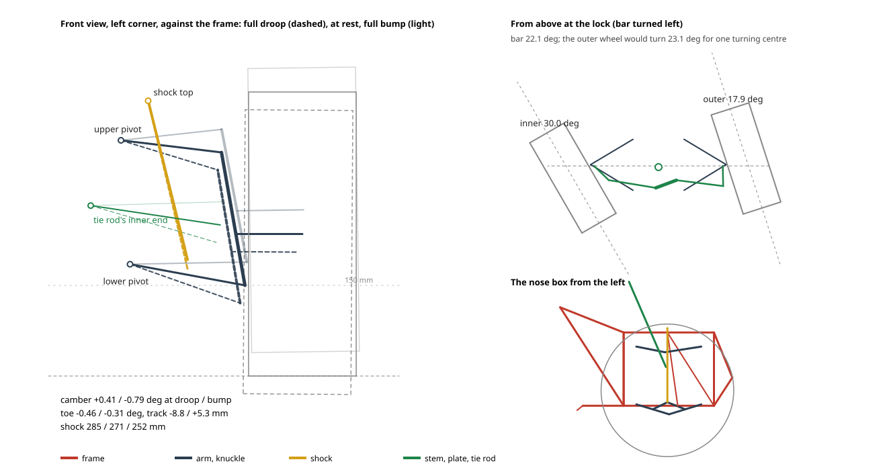

# 1.3 Design calculation

Calculations, one section per item, each with an id that values and checks can cite.

This step designs the straddle kart the owner chose (D-030): ridden astride by riders of 6 and up, leaning into turns, with the engine unit under the seat. The seated kart that stood here before is in the repository's history; its checks K-004 to K-006 and K-009 judged that kart. Where the owner has not yet decided the proposals of [1.2.18](02-form.md#straddle), this step takes them as its working basis: R-12 at kart.tip_ratio_snow_min sideways and law.quad_pitch_ratio_min fore and aft (Q-032), and a protective hoop behind the seat for R-19; the children's speed is left open. The owner chose buggy-size tyres all year with skis inside the front wheels in winter (D-032), springs at the rear (D-036), a frame made low, small, and cheaper where its shape allows (D-037), 150 mm under the frame for rough ground (D-038), springs at the front too (D-039), and a frame shaped and detailed for fatigue (D-040). A change there comes back to this step.

`python calc/design.py --write` reads every input from the record and writes the calculated values (keys starting with `dsn.`) and `docs/data/design.json`, the geometry that the navigator's drawings and 3D view draw. It solves the frame as a space frame of tubes (`calc/frame.py`) and searches the geometry for interferences (`calc/clash.py`). Axes are x forward, y left, z up, with the origin on the ground under the rear axle centre. Inputs that have no source yet are assumed in Q-017, Q-023, Q-033, Q-036, Q-039, and Q-040.

## 1.3.1 Layout {#layout}

- Buggy-size tyres of yr.tyre_dia_mm stay on all year, yr.front_width_mm wide at the front and yr.rear_width_mm at the rear, as on the 50 cc buggies registered as minicars (M90; sizes assumed, Q-036) (D-032).
- The wheelbase lay.wheelbase_mm and the overhangs lay.front_overhang_mm and lay.rear_overhang_mm, with the tyres reaching past both ends, make the kart dsn.length_m long, inside the Delica's cargo length (R-14). The wheelbase stays a little longer than those buggies' so that the riders' toes clear the front tyres at full lock (1.3.16).
- The front and rear tracks are lay.track_front_mm and lay.track_rear_mm, with fenders lay.fender_margin_mm wider than the tyres (R-30), so the kart is dsn.width_m wide, inside the car's tailgate opening. The height to the mirrors or the hoop is dsn.height_m.
- The engine unit lies along the centre line under the seat (lay.unit_y_mm), so the kart is symmetric: the centre of mass lies dsn.cg_side_adult_mm to the side with the adult.
- **Low, small, and clear of the ground (D-037, D-038).** The engine unit sits on rubber mounts on its plate on the spine rails, which run lay.rail_bottom_mm above the ground with the sled pan right under them. The pan's dsn.clearance_mm is the ground clearance the owner chose for rough ground (1.3.19); it puts the seat at lay.seat_height_mm. The track, the hoop, and the handlebar came down and in when the seat was lower (D-037) and keep the stability of 1.3.9 at the higher frame, just.

## 1.3.2 Frame {#frame}

- **Tubes.** The frame is of three tube sizes, dsn.rail_od_mm by dsn.rail_t_mm, dsn.box_od_mm by dsn.box_t_mm where the stress map of 1.3.21 found the larger idle, and dsn.cross_od_mm by dsn.cross_t_mm STKM11A (M6); the bearing outriggers and the kick of the spine over the axle are gone. It has:
    - two spine rails at ±lay.spine_half_width_mm under the engine unit, from the swing arm's pivot at lay.pivot_x_mm forward to a cross tube at the nose box's rear, of the larger tube because the spine carries the standing rider (1.3.18);
    - at the front, a nose box for the A-arms of 1.3.20 (D-041). Its lower rails run at ±lay.nose_lower_y_mm from that cross tube to the front, its top rails at lay.nose_top_z_mm come forward from the seat rails, and uprights at the rear and posts at the front stand lay.nose_post_offset_mm outside the arms' pivots, so that the pivots' clevises sit on the rails clear of them. Its side panels are triangles but for one bay, which the tie rods and the stem's plate sweep through; that bay's shear goes round it in the bending of its rails and posts, at most dsn.nose_bay_stress_mpa in the driving cases (K-017). Its front and rear panels have no braces: the stress map of 1.3.21 found them carrying almost nothing. One top cross tube carries the shocks' tops and, bolted to its back, the stem's upper flange bearing, dsn.stem_top_tube_gap_mm clear of the stem; the lower bearing sits on a bottom cross tube under the stem's foot. So every load of the front - arms, shocks, stem - enters at a node. The bumper, braced by two struts to the box's front corners, stands ahead of the front tyres (lay.front_overhang_mm), so that it, not the arms, meets a post or a wall (1.3.18);
    - seat rails of the larger tube under the saddle, from the upper rails forward and down to the spine's ends ahead of the engine unit, which carry the seat and make the spine and the seat rails work as a truss (D-040);
    - three cross tubes and an outer tube either side under each footboard;
    - behind the unit, posts at ±lay.post_y_mm rising upright from the rails' rear cross tube through the pivot tube to two upper rails under the seat's rear, clear of the swing arm's sides;
    - struts from the posts to a cross tube on the shock's axis just beyond its upper eye, so each side closes into a triangle and the shock's load closes within it; the struts cross the upper rails at a joint;
    - the protective hoop of 1.3.13 on the struts' tops.
- **Lengths and mass.** dsn.tube_main_m of the larger tube, dsn.tube_box_m of the middle, and dsn.tube_cross_m of the smaller go into the frame and the front A-arms, dsn.tube_roll_m into the hoop, and dsn.tube_arm_m into the swing arm of 1.3.17. The frame weighs dsn.frame_mass_kg, with more in plates.
- **Strength (R-02).** The tubes are solved as a space frame (`calc/frame.py`): each tube a beam; the rear swing arm pinned on its pivot and held by its shock taken as a rigid link; each front A-arm hinged at its two pivots, the knuckle hung on two ball joints and held from turning by its tie rod, the lower arm held by its shock, all as links; the knuckle and wheel stiff down to the tyre's contact, where the kart stands, so that the arms get the wheel's whole lever; and the rear on the arm's bearings. The load cases are those of 1.3.18, for rough ground. In the driving cases the largest stress is dsn.rail_stress_mpa, with the adult standing in a bump, in a cross tube under a footboard: a safety factor of dsn.rail_safety on the tensile strength dsn.stkm11a_tensile_mpa, against the dsn.frame_safety_min taken so that the tubes stay below yield (STKM11A has no stated yield; Q-017). It sags dsn.frame_deflection_mm in the seated bump. Its fatigue life is in 1.3.18.

## 1.3.3 Rear axle {#axle}

- A keyed steel shaft of dsn.axle_dia_mm (S45C, M35) and lay.axle_length_mm in two UCP207 pillow blocks (sizes and price assumed, Q-039) hung under plates on the swing arm's sides at ±lay.bearing_y_mm. The axle sprocket sits just outside the left bearing, where it takes the chain's pull, and the brake disc outside the right one at lay.brake_y_mm. The hubs sit dsn.hub_bearing_gap_mm outside the bearings. A middle bearing is no longer needed.
- A bump on each rear wheel with the adult times the load factor, the chain's pull of dsn.axle_chain_pull_n at full torque, and that torque twisting the shaft, combined by von Mises, stress the axle to dsn.axle_stress_mpa, a safety factor of dsn.axle_safety on dsn.s45c_yield_mpa (Q-017). The bearings sit further in than before to clear the tyres, so the wheels overhang more and the shaft is larger, sized for the bump of 1.3.18. Each bearing carries roughly dsn.bearing_load_n at rest, far below its rating.
- The lowest part of the kart is the sled pan at dsn.belly_height_mm; of the axle's parts the lowest is at dsn.low_point_mm above the ground (R-04).

## 1.3.4 Drive {#drive}

- A used 50 cc four-stroke scooter's engine unit (D-022, R-26), with its CVT (eng50.cvt_low to eng50.cvt_high, P43), centrifugal clutch, final reduction su.final_ratio, ECU, fuel pump, and silencer; its size su.length_mm by su.width_mm by su.height_mm and mass su.mass_kg are assumed until the donor is measured (Q-023).
- It lies under the seat as in the scooter, cylinder forward, its output at the rear end lay.unit_out_x_mm ahead of the axle on the left at lay.chain420_y_mm. A chain of size 420 runs from a gear.t_out420 tooth sprocket to a gear.t_axle420 tooth sprocket beside the left bearing: dsn.chain420_links links at a centre distance of dsn.chain420_centre_mm, which changes by dsn.chain_centre_change_mm over the suspension's travel (1.3.17); a tensioner with a spring roller on the arm takes up the slack (M103). The gearing gives the axle sprocket's bottom the ground clearance of 1.3.19. The unit's front end is at dsn.unit_front_x_mm.
- Overall reduction dsn.ratio_top at the CVT's top ratio gives dsn.top_speed_kmh at the rev limit, within kart.speed_max_kmh (R-01); dsn.ratio at its low ratio.

## 1.3.5 Brake {#brake}

- Two systems as on the scooter (R-21): the right lever works a hydraulic caliper on a disc of lay.disc_dia_mm on the axle at lay.brake_y_mm (M42); the left lever works, through a cable splitter, drum brakes of about lay.front_drum_dia_mm in the ATV front hubs (M93; Q-037); a lock on the right lever holds the kart parked.
- To stop from kart.speed_max_kmh within kart.stop_distance_max_m with the adult (R-09) needs dsn.brake_decel_needed. Braking moves load onto the front wheels, so the rear tyres pass only part of it: the rear caliper then clamps dsn.brake_clamp_needed_n, with pad friction dsn.pad_mu, and each front drum brakes its wheel with dsn.brake_front_torque_needed_nm; both levers are used together. The rear brake alone stops at dsn.brake_rear_alone_decel on pavement. Whether the front drums give that torque is a 1.4 item (Q-037); on ATVs of this size they are the front brakes (M97).
- Downhill on the grass slope the straddle kart carries less on its rear wheels than the seated kart did: the rear brake alone decelerates at dsn.brake_downhill_decel_rear, which does not stop it. With the front brakes too, every wheel brakes, giving dsn.brake_downhill_decel and a stop of dsn.brake_downhill_stop_m from top speed. This is why the second system is on the front wheels. That stop is longer than kart.stop_distance_max_m, which R-09 sets on level pavement; slopes are descended at walking pace (OP-02.04).

## 1.3.6 Steering {#steering}

- The donor scooter's handlebar, lay.bar_width_mm wide, at lay.bar_x_mm and lay.bar_z_mm, on a stem raked dsn.stem_rake_deg in two UCFL204 flange units (M40) on the nose box's cross tubes (1.3.2). The ATV steering knuckles with 17 mm spindles (M92) turn on a kingpin through the A-arms' outer joints (1.3.20), lay.kingpin_y_mm from the centre line at the spindle's height, inclined lay.kpi_deg inward and lay.caster_deg back; the scrub radius is dsn.scrub_radius_mm and the trail dsn.trail_mm. A bar handle needs no impact-absorbing steering (P70).
- The knuckles' arms, lay.steer_arm_mm long (assumed until the knuckles are measured, Q-044), point back and in by lay.steer_arm_angle_deg. A plate on the stem, its arm as long as theirs and square to the stem, carries at its end a cross bar with the inner ends of the two tie rods of M10 rod ends PHS10 (P34, M38), ±lay.tie_inner_y_mm from the centre line at dsn.tie_z_mm off the ground, the height at which the toe changes least as the springs move (1.3.20). The tie rods are dsn.tie_rod_length_mm long and lie across the kart.
- **Lock.** The steering is solved as built: the bar turns the plate, each tie rod pulls its knuckle round its own kingpin. The bar turned dsn.bar_lock_deg brings the inner wheel to lay.steer_max_deg; the outer wheel then turns dsn.steer_outer_deg, where dsn.steer_outer_ideal_deg would put all four wheels on one turning centre. The front thus steers with more Ackermann than one centre needs. Arms turned out to -10 degrees in plan would bring the outer wheel to dsn.steer_outer_alt_deg, but the toe would then change by up to dsn.bump_steer_alt_deg over the travel against dsn.bump_steer_lock_deg now, so the arms stay as they are (Q-044). The smallest turning radius is dsn.turn_radius_m by the inner wheel and dsn.turn_radius_outer_m by the outer.

## 1.3.7 Seat, footrests, and fit {#fit}

- The donor scooter's seat sits on the engine unit and, at its rear, on the upper rails, its top lay.seat_height_mm above the ground, from lay.seat_x0_mm to lay.seat_x1_mm and lay.seat_width_mm wide, dsn.saddle_thickness_mm thick. The adult's hip is at lay.hpoint_x_mm, dsn.seat_drop_adult_mm above the footboards.
- Footboards lie beside the unit at lay.footrest_height_mm, from lay.foot_x0_mm to lay.foot_x1_mm, between lay.foot_y0_mm and lay.foot_y1_mm from the centre line, on three cross tubes and an outer tube, with a toe board at the front edge. A child sits further forward at lay.child_hip_x_mm on steps of lay.child_foot_raise_mm bolted on the footboards (R-03, D-030).
- Standing on the steps, the smallest rider's crotch clears the seat by dsn.child_fit_margin_mm more than the rider.child_fit_clear_mm of youth ATV guidance (P69), with the crotch height assumed at rider.child_crotch_ratio of stature (Q-033).

## 1.3.8 Mass {#mass}

- The kart's parts sum to dsn.mass_kg, with the centre of mass at dsn.cg_x_m ahead of the rear axle and dsn.cg_z_m above the ground; `docs/data/design.json` lists each part's mass.
- With the adult the rear wheels carry dsn.rear_share_adult and the centre of mass is at dsn.cg_height_adult_m; with the child, dsn.rear_share_child and dsn.cg_height_child_m.

## 1.3.9 Stability {#stability}

- Half the track at the centre of mass over its height is dsn.tip_ratio_adult with the adult and dsn.tip_ratio_child with the child; the shorter half of the wheelbase over the height is dsn.pitch_ratio_adult and dsn.pitch_ratio_child. The working basis asks kart.tip_ratio_snow_min sideways and law.quad_pitch_ratio_min fore and aft, above Australia's tilt-table minimums for quad bikes with a rider (P66); the owner decides (Q-032).
- The adult's hip sits at lay.hpoint_x_mm, where the toes clear the front tyres at full lock (1.3.16); the lower centre of mass keeps the fore-and-aft margin with it.

## 1.3.10 Climbing {#climb}

- On site.grade_max_pct of long grass (ground.crr_max) with the adult, climbing needs dsn.climb_force_n; the rear tyres pass dsn.climb_grip_n at the assumed grip ground.mu_grass (Q-014), and the engine gives dsn.climb_thrust_n. The steepest grass slope the rear tyres climb is dsn.climb_grade_max_pct, short of the assumed site.grade_max_pct (Q-008). D-021 lets the slope follow what the kart can do; the rider leaning forward uphill, as on a quad, takes still more weight off the rear.

## 1.3.11 Transport {#transport}

- The kart goes into the Delica as it is: dsn.delica_length_margin_mm shorter than the cargo length, dsn.delica_width_margin_mm inside the widest tailgate opening, and dsn.delica_height_margin_mm under the cargo height (R-14, OP-05). Whether it passes the opening at floor height waits for the owner's measurement (Q-015).

## 1.3.12 Winter form {#winter}

The winter form is W6 of [1.2.19](02-form.md#tyres) (D-032): the kart keeps its wheels, skis bolt beside the front wheels, and chains go on the rear tyres as needed. The change of form is OP-04 and back OP-06 (R-28).

- **Skis.** Skis of ski.width_mm by ski.contact_length_mm on the snow bolt to the steering knuckles inside the front tyres, lay.ski_gap_mm clear of them, at dsn.ski_y_mm from the centre line, on brackets that pivot with rubber stops and adjust in height: below the tyre for deep snow, which lifts the front wheels, or a little above it where the ground is firm, so that the tyre rolls and keeps its brake until it sinks. They steer with the wheels, clear of the front brake drums and the tie rods. With the adult they press dsn.winter_ski_pressure_kpa when they carry the front.
- **Chains.** Ladder chains on the rear tyres (P1, S1) for grip on packed snow and ice.
- **Mass and stability.** The winter kart weighs dsn.winter_mass_kg. With the adult its centre of mass is dsn.winter_cg_height_m high and the rear tyres carry dsn.winter_rear_share. With the skis carrying the front their stance is narrower than the front track, and the tipping ratio is dsn.winter_tip_ratio against kart.tip_ratio_snow_min (R-12, D-025); fore and aft it is dsn.winter_pitch_ratio, since nothing is lifted. How the tyres and skis do in fresh snow is in 1.2.19.
- **Sled pan.** A UHMW polyethylene plate hull.bottom_t_mm thick under the spine, dsn.belly_height_mm above the ground, with a bow in three panels rising lay.bow_rise_mm under the nose box and narrowing to ±lay.bow_half_beam_mm, between the lower A-arms and clear of the shocks; it weighs dsn.pan_mass_kg and keeps the spine from ploughing when the tyres sink.
- **Future water version (D-027).** Not required. The 3D view shows it as an option: side floats of lay.float_dia_mm on arms outside the wheels, and an electric outboard with its battery at the stern. 1.2.15 holds its basis.

## 1.3.13 Protective hoop and road equipment {#rollbar}

- A hoop of dsn.rail_od_mm tube behind the seat at lay.hoop_x_mm, standing on the struts' tops of 1.3.2 and braced to the upper rails' rear ends, rising to lay.rollbar_top_mm, meant to hold the kart off a rider it lands on, as the protection devices that Australia requires on quad bikes do (P66, P68); dsn.tube_roll_m of tube. A straddled seat needs no seat belt, head restraint, or 1 m marker (P70).
- The road equipment of R-20, R-21, and R-23 comes from the donor scooter where it can: the head lamp on the handlebar, beside an LCD meter with its own wheel sensor (M94), mirrors outside the bar ends so that they clear the riders' arms at full lock, front turn signals above the bumper inside the tyres' sweep, rear turn signals on the hoop, the tail and stop lamp, reflector, and number plate with its lamp on the upper rails' rear ends, the horn at the front, and the battery on the upper rails behind the shock. Fenders cover the tyres (R-30); they are ATV fenders as sold (M95), their mass dsn.fender_mass_kg and the road kit's dsn.road_kit_mass_kg assumed (Q-033, Q-023).

## 1.3.14 Guards and stopping {#safety}

- R-10: the donor's throttle grip springs back when released; a stop switch on the handlebar and a tether switch clipped to the rider (M50) are wired to the engine's stop circuit.
- R-11: a steel guard on the swing arm covers the chain's upper run and the sprockets' tops from the rider's side, and tubes on the arm cover the turning axle between the bearings and the hubs (P17, P19).
- R-13: the footboards and the front bumper keep the rider's feet inside the kart; riders wear the gear of R-31.

## 1.3.15 Where the engine sits {#engine-position}

- Under the seat along the centre line, as in the scooter it comes from (D-030). Beside the seat it made the seated kart wide; under the seat the kart is as narrow as its track allows and still fits the car's length. The centrifugal clutch stays, since the engine must idle while the kart stands and the clutch lets go when the throttle is released (R-10).

## 1.3.16 Layout checks and issues still open {#issues}

- **Interference search (Q-035).** `calc/clash.py` builds every part as the 3D view draws it, the frame tubes and the riders as capsules, and measures the smallest gap between every pair that is not mounted on each other. It runs in the summer and winter forms, straight and at the lock both ways - the bar turned dsn.bar_lock_deg and each knuckle as far as its tie rod turns it, with the front wheels, knuckles, skis, fenders, tie rods, and handlebar - and at the ends of the rear suspension's travel (sus.bump_mm up and sus.droop_mm down); it moves each front corner's arms, knuckle, and shock through the same travel, one side and both together, straight and at the lock both ways (`calc/front.py`). It finds dsn.clashes_summer pairs closer than 5 mm in summer and dsn.clashes_winter in winter.
- **What it found and changed.** The first search of the earlier layout found the bearing outriggers inside the rear tyres, the riders' feet, the front fenders, and the turn signals in the front tyres' sweep at full lock, the skis' brackets through the front beam, and tie rods that changed length by about 45 mm. The layout of 1.3.1 to 1.3.17 answers these: the arm's bearings sit inside the tyres, the front fenders turn with the knuckles, the feet stop at a toe board, the skis' brackets stay under the beam, and the pitman arm sets the tie rods' length. For the A-arms of D-041 the search was also run with the joints' spheres taken away, so that nothing but real joints hides behind them; it found pivots too close to the box's posts, an upper bearing's tube crowding the box's rear corner, a seat diagonal against the engine, and the sled pan's bow under the lower arms, all moved; an independent check then found the inner wheel, at the lock and full droop, in the pan's front corner, a state the search had not visited, and the pan was narrowed and the state added (K-017). What remains in the joints' spheres is joints: the arms' ends at their pivots and the knuckle's joints, the shocks' eyes on their lugs, the flange bearings on their tubes; and the tyre stands within 5 mm of the lower arm's outer end in every position, since the wheel turns about the kingpin through it, to be seen on the knuckles in hand (Q-044).
- **Still open.** The stability margins are just at the working basis with the higher frame (1.3.9), and the fatigue life rests on the joints being made as 1.3.18 says. The grass slope the kart climbs is less than assumed (1.3.10). The fit of the ATV front knuckles, drum hubs, wheels, and meter is unstated by their sellers, and the drum brakes' parts, the ski brackets, and the axle sprocket are allowances (Q-036, Q-037). The bearings' sizes, the shock's stroke, and the target frequency are assumed (Q-039).
- The rider's thighs pass round the engine unit, which is wider than the seat; the adult's knees bend well, about as on a youth quad. Both are to be tried on the built kart.

## 1.3.17 Rear suspension {#suspension}

The owner asked whether the wheels should follow the ground on springs (Q-038). Springs keep the tyres pressing on rough ground for steering and braking, cut the shock loads on the frame, and spare the rider. The rear comes first, since most of the rider's weight is on it (D-036); the front stays rigid on its low-pressure tyres.

- **Arm.** The axle's two bearings hang under the swing arm's sides at ±lay.bearing_y_mm, inside the chain, so that no tube of the arm crosses the chain's loop. The arm turns on a pivot tube at lay.pivot_x_mm, just behind the engine unit and level with its output shaft, so the chain's centre distance changes by dsn.chain_centre_change_mm over the travel, which a spring tensioner takes up.
    - Its sides bend level just ahead of the bearing plates, where a brace joins them.
    - A cross tube behind the axle closes the arm.
    - It is dsn.tube_arm_m of the larger tube.
    - Its largest stress is dsn.arm_stress_mpa, a safety factor of dsn.arm_safety, in the cases of 1.3.2.
- **Shock.** One shock of shock.eye_mm between the eyes (M100) runs from a lug lay.shock_low_rise_mm over the arm's sides at lay.shock_low_x_mm, up and back, to the frame's cross tube near lay.shock_top_x_mm.
    - Its motion ratio, the shock's travel per unit of the wheels' travel, is dsn.motion_ratio.
    - The wheels move sus.bump_mm up and sus.droop_mm down from the laden position. That uses dsn.shock_stroke_used_mm of the shock's assumed shock.stroke_mm stroke in bump (Q-039), dsn.shock_travel_mm in all.
    - Laden it is dsn.shock_length_static_mm long.
    - The axle clears the struts above it by dsn.axle_rail_gap_mm at full bump.
- **Spring.**
    - For a natural frequency of sus.freq_hz, stiffer than a full-size quad's because the travel is short (Q-039), the rear wheels' rate with the dsn.rear_sprung_kg on them is dsn.rear_wheel_rate_n_mm. They sag dsn.rear_sag_mm laden.
    - The spring at the shock is dsn.shock_spring_n_mm, chosen when the shock is bought.
    - The shock carries dsn.shock_force_static_n at rest and dsn.shock_force_bump_n in the bump case of 1.3.2.
- **The front** is sprung too, on double A-arms (1.3.20, D-041).

## 1.3.18 Loads on rough ground {#loads}

The owner asked whether the load cases were right for a kart that also runs on rough ground. They were not. The frame had been checked for a 2.5 g bump, a standing rider, and one lifted wheel at 1.5, with nothing to source them. Published frame load cases for small vehicles are higher and more varied, and an independent helper checked the cases, the solver, and the results below (K-014).

- **Driving cases**, each checked against dsn.frame_safety_min on tensile strength:
    - a bump of load.bump_g, with the adult seated and standing - the figure racing-car frames are designed to, for durability (P72, P73); road-vehicle figures are 2 to 3 and higher off road (S8);
    - one front wheel lifted, at load.twist_rough, the rough-road figure for torsion (S8);
    - braking at load.brake_g and cornering at load.lateral_g, each with the weight (P72);
    - combined: load.combined_vert_g vertical with load.combined_brake_g braking and load.combined_lat_g sideways (Q-040).
- **Accident cases**, each checked against load.accident_safety_min - the tubes may bend but must not break (Q-040):
    - a frontal impact at load.impact_g, met by the whole bumper or by one end of it against a post or tree. Baja cars are designed for 8 to 10 g at 56 km/h head on (P74, P75); scaled to this kart's speed with the same stopping time this is 4.3 to 5.4 g (Q-040). The bumper stands ahead of the front tyres, so it meets a wall first (K-015).
    - the hoop crushed from above by load.hoop_crush_n_per_kg per kilogram of the kart, as tractor rollover structures are tested (P76);
    - the hoop pushed sideways by load.hoop_side_g of the kart's weight (Q-040).

    Both hoop loads are applied with the frame held at its spine and the rider's mass left out, as rollover structures are tested. The hoop is there to hold the kart off the rider. Loaded the other way, held at the hoop with the kart's masses pushing, the result changes a good deal (K-014, Q-040).
- **First result.** The frame of D-037 fell short: the spine at a safety factor of about 1.1, the bumper's thin tubes breaking in the impact, the hoop's base only just holding, and the axle below 1.5. The frame was changed with the ride height of 1.3.19 (D-038):
    - spine rails of the larger tube, dsn.rail_od_mm;
    - a dsn.axle_dia_mm axle;
    - the bumper of the larger tube, braced to the kingpin bosses;
    - the hoop standing on the struts' tops.
- **Now:**
    - the frame's safety factor is dsn.rail_safety, the swing arm's dsn.arm_safety, and the axle's dsn.axle_safety;
    - in the frontal impact the frame's safety factor is dsn.impact_safety;
    - the hoop takes the crush at dsn.hoop_crush_safety and the push at dsn.hoop_side_safety.
- **Drops.** A wheel landing from a drop stops within the stroke it has: the tyre's usable deflection land.tyre_defl_mm (Q-040), and at the rear also the shock's travel from full droop to full bump. A tyre takes the energy at an efficiency of land.tyre_eff, a coil-spring shock at land.shock_eff (S9).
    - From a drop of land.drop_ref_mm the front lands at dsn.landing_front_g and the rear at dsn.landing_rear_g.
    - Rigid, the front landed at about 8.5 g and reached the bump case at a drop of about 3 cm. With the springs of 1.3.20 (D-039, D-041) both ends reach it at a drop of dsn.drop_front_at_bump_mm and dsn.drop_rear_at_bump_mm.
- **Fatigue.** Rough ground loads the frame over and over. Welded joints last without limit below their fatigue limit, (2/5)^(1/3) of the detail category divided by a partial factor of fat.gamma_mf, the factor for a long life with grave consequences (S10, S11).
    - The limits:
        - for a tube butt-welded or welded to a plate (category fat.cat_tube_mpa) the limit is dsn.fatigue_limit_tube_mpa;
        - for a fillet-welded joint with an intermediate plate (fat.cat_fillet_mpa) it is dsn.fatigue_limit_fillet_mpa.
        - The frame's tube-to-tube joints are neither, so these stand in for them (Q-040).
    - The worst of the bump and lifted-wheel cases, per g, gives dsn.fatigue_range_mpa in the worst tube for a repeated range of fat.range_g.
    - That is unlimited only for ranges up to dsn.fatigue_g_tube at the first kind of joint and dsn.fatigue_g_fillet at the second.
    - At fat.range_g the first kind of joint stays below its fatigue limit, so its life has no limit (recorded as dsn.fatigue_kcycles_tube); the second would last about dsn.fatigue_kcycles_fillet thousand cycles, as many kilometres at one such bump a metre.
    - The frame was shaped and its joints set for this (D-040):
        - the seat rails of 1.3.2 make the spine a truss, and the swing arm's rear cross tube, which one lifted wheel loads most, is of the larger tube (K-015); the keel that K-015 also enlarged gave way to the nose box of D-041;
        - the tubes are fitted to each other and welded all round, the first kind of joint;
        - no intermediate plates are fillet-welded on the spine, the posts, or the footboards' supports, so the second kind does not occur there;
        - gussets go where the posts and struts meet.
    - The frame is to last fat.life_kcycles_min thousand such ranges. Since the stress map of 1.3.21 thickened the cross tube one lifted wheel works hardest, the first kind of joint has no limit (the ratio to the target is recorded as dsn.fatigue_life_ratio, standing for no limit).
    - Before each day's riding the welds are looked over for cracks (OP-01.07), since a fatigue crack shows long before it breaks.

## 1.3.19 Ground clearance {#clearance}

- **Against quads.** Youth quads, meant for children on easy ground, stand atv.clear_youth_low_mm to atv.clear_youth_high_mm off the ground (P77, P78). Small sport quads stand atv.clear_sport_small_mm (P79) and utility quads up to atv.clear_utility_mm (P80). The frame of D-037 stood 100 mm under its sled pan, at the youth quads' level, so on rough ground with ruts deeper than about 10 cm it would ground its belly.
- **Chosen.** The owner chose a small sport quad's clearance (D-038). The frame and the pan right under it went up, and the seat back to lay.seat_height_mm:
    - the pan stands dsn.clearance_mm off the ground and the spine rails dsn.clearance_no_pan_mm;
    - the axle's lowest part stands dsn.low_point_mm;
    - a crest under the middle of the wheelbase is cleared up to dsn.breakover_deg, leaving out the tyres' radius;
    - in a full bump of the rear springs the pan's rear end comes down to dsn.clearance_bump_rear_mm.
- **What it cost.** The seat is higher than D-037 made it. The stability margins are just at the working basis, dsn.tip_ratio_adult sideways in summer, dsn.winter_tip_ratio in winter, and dsn.pitch_ratio_adult fore and aft (1.3.9). The child's fit margin is dsn.child_fit_margin_mm (1.3.7).

## 1.3.20 Front suspension {#front-suspension}

The front of D-039 - two swing axles, a keel, a tower, and stays for the stem - grew by moving tubes until the checks passed, and the owner found it no sound structure. 1.2.20 went back to its form; the owner chose double A-arms (D-041). This section designs them in the order of the method: the line diagram and its kinematics, then the line model and its stresses, then the interferences.

- **Form.** Upper and lower A-arms each side, hinged on the nose box of 1.3.2 about axes parallel to the kart's length; the knuckle between their outer ends; one coil-over from a lug on a plate across the lower arm to a lug beside a node of the box's top rail, passing through the upper arm's opening; tie rods from a plate on the stem to the knuckles' arms.
- **Hard points.** At the wheel's centre line, the knuckle's lower joint stands lay.fa_lower_joint_z_mm and its upper joint lay.fa_upper_joint_z_mm off the ground, on a kingpin inclined lay.kpi_deg and raked lay.caster_deg (1.3.6). The lower arm's pivots are lay.fa_lower_pivot_y_mm from the centre line at lay.fa_lower_pivot_z_mm, the upper's lay.fa_upper_pivot_y_mm at lay.fa_upper_pivot_z_mm, each pair lay.fa_pivot_front_x_mm ahead of and lay.fa_pivot_rear_x_mm behind the axle. The lowest joint is the ground clearance of 1.3.19.

    

- **Kinematics.** `calc/front.py` moves the points the figure is drawn from: the lower arm turns about its axis, the upper arm follows so that the knuckle's joints keep their distance, and the knuckle turns about its kingpin as far as its tie rod lets it. Over the travel from sus.droop_mm down to sus.bump_mm up, straight ahead (FE-03, FE-05 of 1.2.20):
    - the camber changes by dsn.front_camber_change_deg in all, the wheel's top leaning in as it rises and out as it drops, so that the outer wheel in a turn stays upright; the track at the ground changes by dsn.front_track_change_mm a side;
    - the toe changes by dsn.bump_steer_deg with the tie rods' inner ends at dsn.tie_z_mm, the height that keeps it least; at the lock by up to dsn.bump_steer_lock_deg;
    - a tie rod that did not let the knuckle turn would have to stretch dsn.tie_rod_change_heave_mm.
- **Shocks.** One per side, of the 290 mm length the rear's seller lists (shock.front_eye_mm, M100), its upper eye placed, as at the rear, so that it carries the front's sag at rest.
    - Its motion ratio is dsn.front_motion_ratio.
    - It is dsn.front_shock_length_static_mm long at rest, dsn.front_shock_length_droop_mm at full droop, and uses dsn.front_shock_stroke_used_mm in a full bump, within the stroke assumed for the rear's (shock.stroke_mm, Q-039).
- **Spring.**
    - Each side carries dsn.front_sprung_kg sprung. At sus.freq_hz that needs a wheel rate of dsn.front_wheel_rate_n_mm, a spring of dsn.front_shock_spring_n_mm at the shock, and dsn.front_shock_force_static_n on it at rest (Q-039).
    - The spring is chosen when the shocks are bought.
- **Arms.** The lower arms of dsn.farm_od_mm by dsn.farm_t_mm, the upper of dsn.farm_upper_od_mm by dsn.farm_upper_t_mm, since they carry little (1.3.21). In the cases of 1.3.18 the arms work mainly in tension and compression; the lower arm's rear leg, between the shock's plate and the knuckle's joint, bends most, about 63 MPa with the adult standing in a bump - a safety factor of about 4.6 on the tensile strength dsn.stkm11a_tensile_mpa - against about 23 MPa in braking and 69 MPa when one end of the bumper meets a post (K-017 checked these by hand). The shock carries about 3,000 N in the seated bump and 3,200 N in the standing one, 3.5 and 3.8 times its load at rest, and a tie rod about 140 N.
- **Frame.** The box of 1.3.2 takes the arms' pivots on clevises beside its rails, the shocks' tops and the stem's upper bearing on one top cross tube, and the stem's lower bearing on a bottom cross tube. With it the frame's driving cases are governed by the footboards as before, at dsn.rail_safety; in the frontal impact the bumper's struts take the load into the box's corners, at dsn.impact_safety; and the fatigue life of 1.3.18 is dsn.fatigue_life_ratio times the target.
- **Drops.** From land.drop_ref_mm the front lands at dsn.landing_front_g, above the bump case of load.bump_g; it reaches the bump case at a drop of dsn.drop_front_at_bump_mm, as the rear does (1.3.18), so FE-04 of 1.2.20 is not met. The arms would allow more travel than sus.bump_mm and sus.droop_mm; how much the shocks' stroke allows waits on the shocks (Q-039, Q-044).
- **Interferences.** The search of 1.3.16 moves each corner through its travel, one side and both together, straight and at the lock both ways, and finds dsn.clashes_summer pairs closer than 5 mm in summer and dsn.clashes_winter in winter; run again without the joints' spheres, it finds nothing but joints and the tyre within 5 mm of the lower arm's outer end (Q-044).
- **Still to settle (Q-044).** The bought knuckles (M92) may take ball joints or a kingpin between the arms; their joints' places and their steering arm's length and height are to be measured on the parts in hand before the arms are made, and the hard points set from them. The front steers with more Ackermann than one turning centre needs (1.3.6). The arms' pivot bolts and bushes are not yet priced.

## 1.3.21 Stress map and what it trimmed {#stress-map}

The owner asked to see, for each load case, where the frame is stressed, and to take out what carries too little. The 3D view's stress choice (<a href="../navigator/#/?m=v3d&amp;st=env">the navigator's 3D mode, 応力</a>) colours every tube by its use in a case of 1.3.18: the stress along the tube over what that case allows - the tensile strength dsn.stkm11a_tensile_mpa over dsn.frame_safety_min for the driving cases and over load.accident_safety_min for the accidents, and for fatigue the repeated range a tube joint stands for fat.life_kcycles_min thousand cycles (1.3.18). All loads come at the nodes, so the bending runs straight along each tube and the colour along it is that of the line model itself. Envelopes of all cases, of the strength cases, and of fatigue are offered too.

- **First reading.** On the front of D-041 as first built, 37 of 132 tubes (6.7 m) used less than 15 % of what they could in every case, strength and fatigue alike, and only 6 (0.7 m) more than 60 %:
    - idle - the nose box's front and rear panels (posts, bottom cross tubes, and V braces, 3 to 12 %), the bumper and its struts (6 to 12 %), the upper A-arms (4 to 11 %), and the hoop's tubes (9 to 11 %);
    - busiest - the rear cross tube under the seat (88 % in fatigue, from one lifted wheel), a footboard's support and the swing arm's brace (67 and 68 %), and the lower A-arms' legs by the shock's plate (61 to 65 %).
- **Fed back to the form.** The box's front and rear panels lose their V braces: they carried under 4 %. Without them each case's largest stress changes by 5 % or less and the box sways under a sideways kilonewton at a top corner by 0.13 mm rather than 0.07 mm, the panels' welded joints taking what little racking there is; the front posts take about a fifth more in a frontal impact, at 12 % (K-018).
- **Fed back to the sizes.** A middle tube, dsn.box_od_mm by dsn.box_t_mm, takes over where the larger one stood idle: the box's lower rails and cross tubes, its top rails ahead of the shocks' node, the bumper and its upper struts. The box's posts take the small tube (dsn.cross_od_mm by dsn.cross_t_mm), and so do the upper A-arms (dsn.farm_upper_od_mm by dsn.farm_upper_t_mm). The bumper's lower struts stay large, since a blow on one end of the bumper takes them to about 60 % in the middle size. The rear cross tube under the seat goes up to the middle size, which takes the frame's worst fatigue range below the tube joints' fatigue limit.
- **Result.** The frame weighs dsn.frame_mass_kg, 4.6 kg less, and the kart dsn.mass_kg. The driving safety factor stays at dsn.rail_safety (a footboard's support); the impact factor is dsn.impact_safety, from about 3.4, against load.accident_safety_min; the hoop's are dsn.hoop_crush_safety and dsn.hoop_side_safety; and fatigue no longer limits the tube joints (1.3.18), though the worst range is only about 9 % under their fatigue limit. The interference search still finds dsn.clashes_summer clashes.
- **Kept although idle.**
    - The hoop: it must hold the kart off the rider in a rollover, where its stiffness and the way it deforms count as much as its stress (P76).
    - The small tubes at the seat's rear end, which carry the tail lamp and the number plate.
    - The open bay's top rails and the shocks' cross tube, which bend (dsn.nose_bay_stress_mpa).
- **What the map does not show.** Loads outside 1.3.18 - lifting and tying the kart for transport, a rider stepping on a tube, a sideways blow on a front wheel - the stiffness the rider feels, and dents. K-018 tried a sideways blow of 2 g at one front tyre and a rider standing on the box's top rail and found nothing near its limit. The fatigue colours are those of a tube joint; where a plate is fillet-welded to a tube the life is shorter (dsn.fatigue_kcycles_fillet thousand cycles, 1.3.18), which is why such plates stay off the busy tubes (D-040, Q-041). The trimmed tubes keep a wall of 1.6 mm or more for the welder of FE-11.
